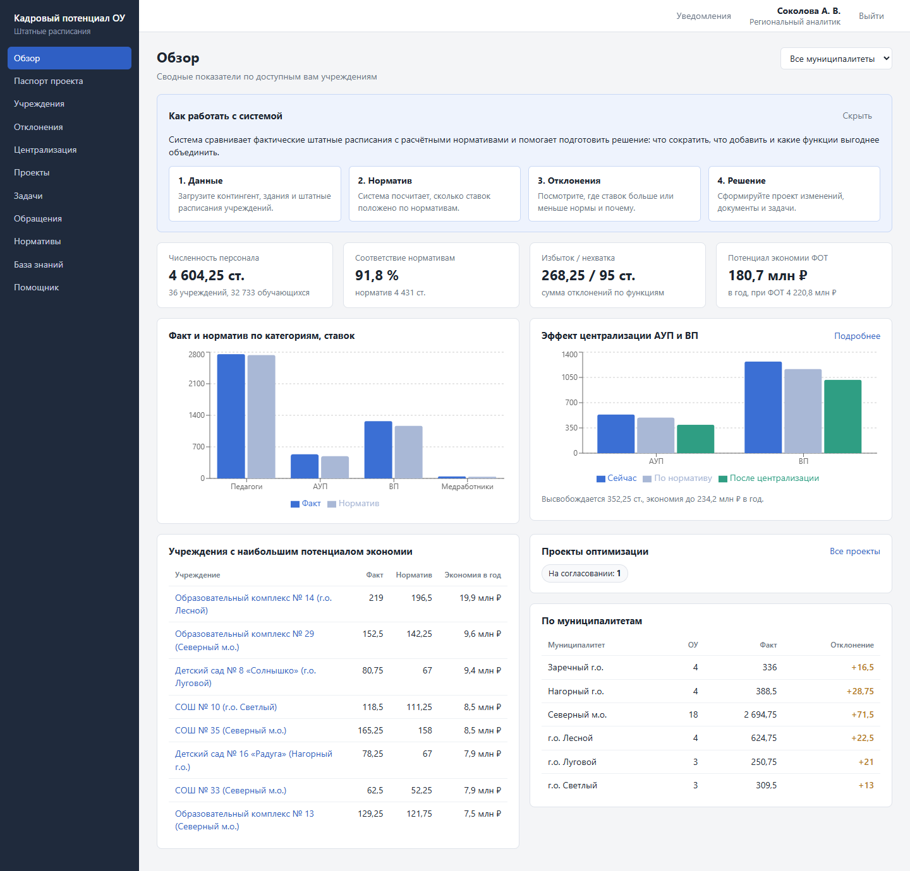
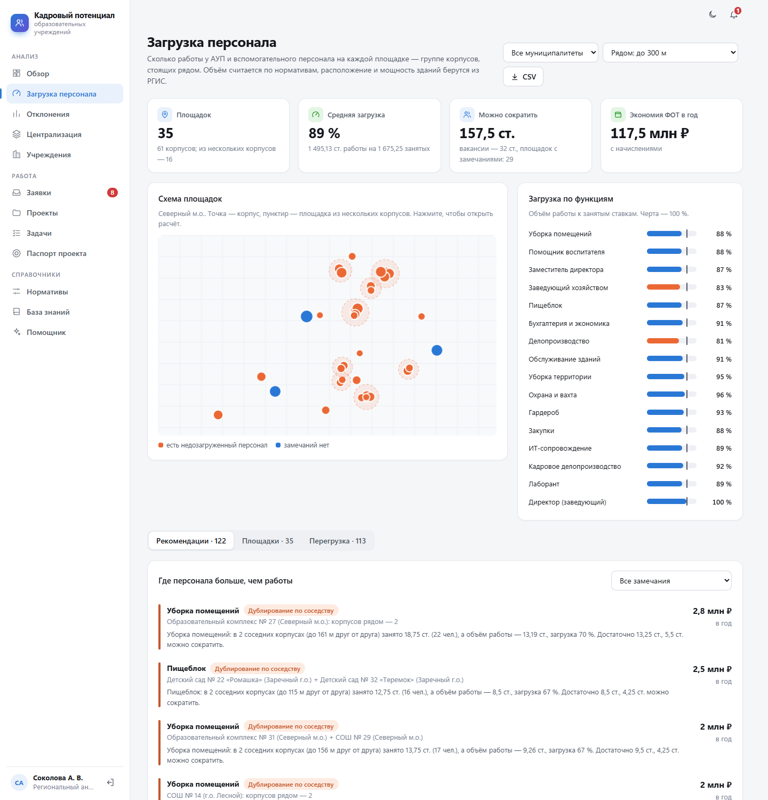

# Кадровый потенциал ОУ

Система показывает, сколько работы на самом деле у административно-управленческого
и вспомогательного персонала школ и детских садов, и помогает довести решение до приказа.

Единица анализа — не строка штатного расписания, а площадка: корпуса, которые стоят
рядом. Если в двух соседних зданиях три человека делают работу, с которой справится
один, система это покажет и напишет, сколько ставок достаточно и сколько из лишних —
вакансии. Расположение, площадь и мощность зданий берутся из выгрузки РГИС.

Кроме анализа в системе есть заявки («починить мебель в кабинете 14») с автоматическим
назначением исполнителя, сроками и перепиской, проекты штатных расписаний с документами,
задачи с диаграммой Ганта и помощник, который отвечает только по базе и загруженным
документам.

Всё разворачивается в Docker и работает без доступа в интернет, включая языковую модель.



## Запуск

Нужен Docker с Compose v2.

```bash
cp .env.example .env      # и заменить в нём пароли и ключи
docker compose up -d --build
```

Интерфейс откроется на <http://localhost:8080>, документация API — на
<http://localhost:8080/api/docs>. Если порт занят, поменяйте `APP_PORT` в `.env`.

При первом запуске применяются миграции, создаются справочники и, если
`SEED_DEMO_DATA=true`, 36 демонстрационных учреждений: половина — в пилотном
муниципалитете, там же заведён паспорт проекта. Данные синтетические и генерируются
с фиксированным зерном, так что цифры от запуска к запуску одинаковые. Названия
муниципалитетов и параметры паспорта задаются в [seed/](seed/README.md).

Учётные записи после первого запуска:

| Роль | Логин | Пароль |
|---|---|---|
| Администратор | значение `ADMIN_EMAIL` | значение `ADMIN_PASSWORD` |
| Региональный аналитик | `analyst@demo.ru` | `demo12345` |
| Специалист управления образования | `municipal@demo.ru` | `demo12345` |
| Директор ОУ | `director@demo.ru` | `demo12345` |
| Наблюдатель | `observer@demo.ru` | `demo12345` |
| Хозяйственная служба ОУ | `executor@demo.ru` | `demo12345` |
| Сотрудник ОУ | `employee@demo.ru` | `demo12345` |

Последние двое видят только заявки: сотрудник — свои, хозяйственная служба — те, что
адресованы ей в своём учреждении. Штатные расписания и аналитика им закрыты на уровне API.

Демо-пользователи создаются только вместе с демо-данными. Для реальной установки
поставьте `SEED_DEMO_DATA=false` — тогда в базе будут только администратор, нормативы
и шаблоны сценариев.

## Локальная модель

Без модели система работает полностью, кроме чата: документы собираются по шаблону,
обращения классифицируются по ключевым словам. С моделью появляется помощник,
а вводный текст документов и разбор обращений делает она.

Подходит любой сервер с OpenAI-совместимым API. Вызов инструментов от модели
не требуется. Проверено на Qwen3-8B (Q4_K_M) в двух вариантах.

**Вариант 1 — модель в Docker.** Положите файл `.gguf` в папку `models/` и добавьте в `.env`:

```dotenv
COMPOSE_PROFILES=llm
LLM_BASE_URL=http://llm:8080/v1
```

После `docker compose up -d` поднимется сервис `llm` на llama.cpp и возьмёт первый
найденный файл (или тот, что указан в `LLM_MODEL_FILE`). В контейнере модель считает
на процессоре.

**Вариант 2 — LM Studio на хосте.** Загрузите модель, включите сервер
(Developer → Start server) и укажите:

```dotenv
LLM_BASE_URL=http://host.docker.internal:1234/v1
LLM_MODEL=qwen3-8b        # идентификатор из http://localhost:1234/v1/models
```

После изменения `.env` перезапустите сервисы: `docker compose up -d`.

### Какую модель брать

Для ноутбука уровня Core Ultra 5 125H с 16 ГБ памяти:

- **Qwen3-4B, Q4_K_M** (около 2,5 ГБ) — разумный выбор по умолчанию. Оставляет память
  для Docker и браузера, с выводами по таблицам справляется.
- **Qwen3-8B, Q4_K_M** (около 5 ГБ) — отвечает заметно аккуратнее, но на 16 ГБ идёт
  впритык. Запускать её лучше через LM Studio: там можно часть слоёв отдать
  встроенной графике Arc, а Docker Desktop на Windows считает только на CPU и по
  умолчанию получает половину оперативной памяти.
- Модели от 14B и квантования выше Q5 на такой машине брать не стоит.

Контекст — 8192 токена (`LLM_CONTEXT`), меньше не надо: в него должны поместиться
системная подсказка и блоки данных под вопрос. `LLM_DISABLE_THINKING=true` выключает
у Qwen3 режим рассуждений, который на процессоре добавляет к ответу минуты.

### На что опирается помощник

Только на два источника: таблицы базы данных и документы, загруженные в базу знаний.
В интернет модель не ходит, инструментов у неё нет, и ссылаться на что-то постороннее
ей не на что. Устроено это так:

1. Вопрос разбирает обычный код (`services/retrieval.py`): по словам в нём определяются
   муниципалитет, учреждение, категория персонала и тема — загрузка по площадкам,
   отклонения, централизация, вакансии, заявки, нормативы, задачи, паспорт проекта.
2. Под вопрос собираются блоки: выборки из базы и фрагменты документов. Они появляются
   в чате сразу, с пометкой «из базы» или «документ», и модель тут не участвует.
3. Модель получает те же блоки и пишет к ним вывод в несколько предложений. Системная
   подсказка запрещает пользоваться чем-либо, кроме блоков.
4. Под ответом перечислены источники: разделы базы и документы с реквизитами.
5. Если под вопрос ничего не нашлось («посоветуй фильм»), модель не вызывается вовсе —
   помощник отвечает, что таких данных в системе нет.
6. Готовый ответ проверяется: если в нём упомянут приказ, закон, СанПиН или ссылка,
   которых не было в переданных блоках, под ответом появляется предупреждение. Проверка
   по реквизитам, а не по смыслу — она ловит выдуманные ссылки на документы, но не
   заменяет чтение ответа.

Заодно это быстро: Qwen3-8B на процессоре выдаёт около 6 токенов в секунду, и схема
«модель сама ходит в базу через инструменты» требовала бы двух-трёх кругов по минуте.
Сейчас ответ занимает 10–40 секунд, а если модель недоступна, чат всё равно покажет блоки.

Все выборки делаются с правами текущего пользователя: директор не получит через чат
данные чужой школы.

Вывод модели стоит читать критически. Итоговые числа считает код и кладёт их в первую
строку блока, чтобы модель не складывала сама, но 8B-модель всё равно иногда путает
соседние строки таблицы. Таблица над текстом — источник истины.

Персональных данных в базе нет (см. ниже), и системная подсказка запрещает модели
обсуждать конкретных людей: на вопрос «кого уволить» она отвечает про функции,
площадки и ставки. Запросы со строками штатного расписания и текстом заявок идут
только в локальную модель. Облачную (`CLOUD_LLM_*`) можно включить для обезличенных
сводных текстов документов; по умолчанию она выключена. Подойдёт любой сервис
с OpenAI-совместимым API, например YandexGPT (пример настроек — в `.env.example`).
Для GigaChat нужен отдельный клиент с получением токена, его пока нет.

## Что умеет система

- **Загрузка персонала.** Корпуса объединяются в площадки по координатам из РГИС
  (по умолчанию — в радиусе 300 м) или по совпадению адреса. Для каждой функции АУП
  и ВП считается объём работы в ставках и сравнивается с занятыми. Результат — загрузка
  в процентах и рекомендация: «в двух соседних корпусах занято 3 ст. (3 чел.), работы
  на 0,9 ст., достаточно 1 ст., 2 ст. можно сократить; из них 1 ст. — вакансия».
  Отдельно показаны перегруженные площадки и здания, заполненные меньше чем наполовину.
  Из рекомендаций формируется проект штатного расписания. Подробнее — ниже.
- **Заявки.** Сотрудник пишет, что нужно сделать; тема, ответственный и срок
  определяются автоматически. Дерево заявок по месту, этапу, исполнителю или теме,
  доска, сводка, карточка заявки с путём по этапам, лентой событий и перепиской.
  Подробнее — ниже.
- **Паспорт проекта.** Табло цели для муниципалитета: сократить ФОТ АУП и ВП
  на заданный процент к сроку. Показывает исходную точку, текущее состояние,
  план и факт по ставкам и часам (1972 ч в год на ставку), расчётный потенциал, долю
  вакансий в нём и дорожную карту. Там же — перечень цифровых инструментов, которыми
  закрываются функции АУП: каждая сокращаемая ставка должна быть обеспечена
  инструментом с покрытием не менее 80 %, и в проектах штатных расписаний это
  проверяется по каждой позиции.
- **Данные.** Контингент по годам, ступеням и формам обучения, здания с адресами,
  координатами и мощностью, штатные расписания с привязкой ставок к корпусам.
  Ввод вручную или импорт CSV/XLSX.
- **Расчёт норматива.** Формула вида «база + коэффициент × показатель / единица»
  с порогом, минимумом, максимумом и шагом округления. Нормативы редактируются
  в интерфейсе, по каждой строке отчёта видно, как получено число.
- **Отклонения.** Избыток и нехватка по функциям и категориям, дублирование функций
  внутри учреждения и между учреждениями, недогруженные ставки, вакансии.
  Выгрузка в CSV.
- **Централизация.** Сценарий передачи бухгалтерии, кадров, закупок, ИТ, уборки,
  охраны и обслуживания зданий в общие центры и бригады в границах муниципалитета,
  с графиком «сейчас → по нормативу → после централизации».
- **Проекты.** Проект штатного расписания формируется из отклонений, проходит
  согласование и утверждение. К нему генерируются приказ, служебная записка
  и обоснование в формате .docx.
- **Задачи.** Конструктор сценариев (цепочка шагов с ролями и сроками), доска задач,
  диаграмма Ганта, напоминания о сроках в интерфейсе и в мессенджере.
- **База знаний.** Загрузка PDF, DOCX, TXT; поиск по смыслу на pgvector; связь
  документов с нормативами.
- **Прогноз.** Линейный тренд контингента и потребности в педагогах на три года.
- **Роли.** Администратор, региональный аналитик, специалист управления образования
  (свой муниципалитет), директор (своё учреждение), наблюдатель (только чтение),
  хозяйственная служба и сотрудник учреждения (только заявки).
- **Аудит.** Входы, изменения данных и нормативов, решения по проектам, вопросы
  помощнику.

Соответствие пунктам ТЗ, включая то, что сделано частично или не сделано, разобрано
в [docs/tz-coverage.md](docs/tz-coverage.md).

## Как считается загрузка



Расчёт лежит в `services/workload.py` — это чистые функции без обращения к базе.

1. **Площадки.** Два корпуса попадают на одну площадку, если между ними по прямой не
   больше заданного расстояния или у них один и тот же дом в адресе («д. 5» и «д. 5,
   корп. 2»). Корпуса разных учреждений тоже объединяются — школа и детский сад через
   забор считаются вместе. Радиус меняется прямо на странице.
2. **Объём работы.** Берутся те же нормативы, что и в остальной системе, но без
   минимумов и округлений: именно они дают «ставку на каждое здание», которая потом
   простаивает. Объём учреждения делится между корпусами по показателю норматива:
   уборка — по площади, гардероб — по числу детей в корпусе, охрана — поровну на здание.
   Число детей в корпусе берётся из фактической наполняемости, если она есть в РГИС,
   иначе пропорционально проектной мощности.
3. **Сравнение.** Объём по площадке округляется вверх до четверти ставки — столько
   достаточно. Если занято минимум на полставки больше, а загрузка ниже 80 %, функция
   попадает в рекомендации: «дублирование по соседству», когда она ведётся в нескольких
   корпусах площадки, или «недозагрузка», когда в одном.
4. **Что не объединяется.** Директор и заместители у каждого учреждения свои, даже
   если здания стоят рядом. Посты охраны считаются на каждое здание, поэтому от
   соседства их не становится меньше.

Чтобы расчёт был точным, ставки должны быть привязаны к корпусам: колонкой «Корпус»
при импорте или в таблице штатного расписания. Непривязанные ставки относятся
к главному зданию, а на странице показывается, сколько их.

Рядом с каждой функцией видно число заявок за 90 дней по её профилю — это косвенный
признак того, есть ли у хозяйственной службы реальная работа.

Чего расчёт не знает: сменности, режима работы зданий, состояния территории. Это
повод разобраться, а не готовое кадровое решение.

## Заявки


Путь типовой заявки «починить дверцу шкафа в кабинете 14»:

1. Сотрудник заполняет одно поле. Тему определяет модель, а без неё — ключевые слова:
   «Мебель и инвентарь».
2. По теме выбираются ответственная служба и срок: аварийная заявка — 4 часа,
   срочная — сутки, плановая — от 2 до 14 дней в зависимости от темы.
3. Исполнителем становится наименее загруженный сотрудник нужной службы в этом
   учреждении. Если службы нет, заявка поднимается к директору, затем в управление
   образования. Статус — «Назначена».
4. Дальше статус меняется от действий, а не вручную: исполнитель ответил — «В работе»;
   задал вопрос заявителю — «Ждёт ответа», срок приостановлен; заявитель ответил —
   снова «В работе», срок сдвинут на время ожидания; исполнитель отчитался —
   «Выполнена»; заявитель принял работу или молчит три дня — «Закрыта».
5. За сутки до срока исполнителю приходит напоминание, о просрочке узнаёт и директор.
   Уведомления видны в интерфейсе и дублируются в мессенджер, если привязан чат.

Пока заявку не выполнили, заявитель может её отозвать — без объяснений, в ленте
останется «Отозвана заявителем». Исполнитель отклоняет заявку только с причиной.

Вся история — кто, когда и что сделал — лежит в ленте заявки. Вести заявку могут
исполнитель, ответственная служба и руководитель в пределах своего учреждения или
территории; переназначить её можно только на того, кто вправе работать с заявками
этого учреждения.

### Как это выглядит

Страница сделана так, чтобы в ней разобрался человек, который видит её первый раз:

- **Этапы сверху.** Семь плашек — «Новые → Назначены → В работе → Ждут ответа →
  Выполнены → Закрыты» и отдельно «Отклонены». На каждой число и пара слов о том, что
  на этом этапе происходит. Щелчок по плашке оставляет в списке только этот этап.
  По умолчанию закрытые и отклонённые скрыты, чтобы не мешали.
- **Дерево.** Заявки разложены по группам, группу можно раскрыть и свернуть. Группировка
  — по месту (муниципалитет → учреждение → корпус), по этапу, по исполнителю или по теме.
  Уровни, где выбирать не из чего, пропускаются: у директора дерево начинается сразу
  с корпусов. В строке группы — полоска с долями этапов, число заявок, сколько
  просрочено и сколько ждут вас. Наверху всегда то, что просрочено.
- **«Ждут вас».** У каждой заявки система знает, за кем ход: исполнителю — взять
  в работу или отчитаться, заявителю — ответить на вопрос или принять работу,
  руководителю — назначить исполнителя, если его не нашлось. Такие заявки подсвечены,
  под названием написано, что сделать, а в меню рядом с «Заявками» горит синий счётчик
  (красный — просроченные).
- **Карточка.** Сверху путь заявки по шагам и одна фраза, что сейчас происходит.
  Внизу кнопки только тех действий, которые доступны именно вам, и синей из них
  будет одна — обычный следующий шаг. Если для действия нужна причина, а поле
  пустое, карточка подскажет, что написать.

Сотрудник и хозяйственная служба видят только этапы и дерево, без сводки и доски:
заявок у них немного, а лишние вкладки только сбивают.

Кадровые вопросы («нужна ставка логопеда», «неверно указана площадь корпуса») идут
тем же путём, только адресат у них — управление образования или региональный аналитик.

## О нормативах

Это важно. Набор нормативов, с которым система запускается, — рабочий, для
демонстрации расчётов. Часть значений опирается на федеральные документы (норма
часов за ставку, специалисты для детей с ОВЗ, выплата за классное руководство) —
они помечены «Федеральный». Остальные помечены «Допущение»: это правдоподобные
значения, а не утверждённые региональные нормы. Перед тем как принимать
по расчётам решения, их нужно заменить в разделе «Нормативы».

То же касается базы знаний: в ней лежат краткие справки, написанные своими словами,
а не официальные тексты. Сами документы загружаются через интерфейс.

## Импорт

Импорт — в разделе «Учреждения». Названия колонок могут быть русскими или английскими,
порядок любой, разделитель — точка с запятой или запятая, кодировка UTF-8 или
Windows-1251.

Штатное расписание:

| Колонка | Обязательна | Примечание |
|---|---|---|
| Организация | да | название, id или внешний код учреждения |
| Должность | да | по ней определяются функция и категория |
| Количество ставок | да | |
| Подразделение, ФОТ, Часов в неделю, Обязанности | нет | |
| Сотрудник / ФИО / Табельный номер | нет | пусто — ставка считается вакантной |

В штатном расписании можно добавить колонку «Корпус» — название здания, его адрес
или код объекта РГИС. По ней ставка привязывается к зданию.

Контингент: Организация, Учебный год, Ступень (дошкольное, начальное, основное,
среднее), Форма обучения, Классов, Обучающихся, ОВЗ.

Здания из РГИС:

| Колонка | Обязательна | Примечание |
|---|---|---|
| Организация / Правообладатель | да | название, id или внешний код учреждения |
| Адрес | да | по нему ищутся соседние корпуса, если нет координат |
| Наименование объекта | нет | название корпуса |
| Код объекта РГИС | нет | по нему здание узнаётся при повторной загрузке |
| Широта, Долгота | нет | десятичные градусы |
| Общая площадь, Этажность | для новых зданий | |
| Проектная мощность, Наполняемость, Год постройки | нет | |

Здание с известным кодом обновляется, новое — добавляется. Пустые ячейки не затирают
то, что уже введено.

**Обезличивание.** ФИО или табельный номер при загрузке превращается в HMAC-SHA256
с секретной солью (`PII_HASH_SALT`) и в исходном виде не сохраняется. Колонки,
которых нет в списке известных, — паспорт, СНИЛС, адрес — не читаются вовсе;
в отчёте об импорте видно, какие были отброшены.

Прямых коннекторов к РГИС, ГИС «Электронное образование», ЕФИС и 1С:ЗУП нет: описаний
их API у меня не было. Вместо этого импорт понимает заголовки типовых выгрузок,
а у учреждения есть поле внешнего кода для сопоставления.

## Устройство

```
web      nginx: статика интерфейса и прокси на /api
api      FastAPI: REST, расчёты, RBAC, аудит
worker   напоминания о сроках и Telegram-бот
db       PostgreSQL 16 + pgvector
backup   ежедневный pg_dump в ./backups
llm      llama.cpp с моделью из ./models (профиль llm)
```

В ТЗ описаны микросервисы. Здесь бэкенд — один сервис с модулями по тем же границам
(`backend/app/services`: нормирование, загрузка по площадкам, аналитика, централизация,
заявки, документы, сценарии, база знаний, помощник, паспорт проекта). Для одного разработчика и одного контура это проще
в сопровождении; `api` не хранит состояния и масштабируется числом экземпляров,
а фоновые задачи вынесены в `worker`, чтобы уведомления не дублировались.

```
backend/app/
  api/         маршруты
  services/    расчёты и интеграции
  bot/         боты MAX и Telegram
  models.py    схема данных
  seed*.py     справочники и генератор демо-данных
backend/alembic/   миграции
frontend/src/      React + TypeScript
seed/              профиль демо-данных: муниципалитеты, паспорт проекта
scripts/           резервное копирование, запуск модели
```

Расчёты — `services/staffing.py` (норматив по учреждению) и `services/workload.py`
(загрузка по площадкам): чистые функции без обращения к базе, поэтому они покрыты
обычными юнит-тестами.

Интерфейс — React без UI-библиотеки: стили, иконки и диаграмма Ганта свои, графики
на recharts. Есть светлая и тёмная тема. Шрифты и иконки не подгружаются из сети.

На синтетике в 1000 учреждений (120 тысяч строк штатных расписаний) сводные
показатели по всему региону считаются примерно за 0,6 секунды. Проверить можно так:

```bash
docker compose exec api python -m app.seed --orgs 1000   # на пустой базе
```

## Безопасность

Сделано в приложении: вход по паролю (bcrypt) и JWT, разграничение доступа по ролям
и территории на уровне API, обезличивание при импорте, журнал действий, локальная
модель для чувствительных запросов, база данных без выхода наружу.

Остаётся на стороне инфраструктуры и до ввода в эксплуатацию обязательно:

- **TLS.** Контейнер `web` отдаёт HTTP. Перед ним нужен обратный прокси с TLS 1.3
  и сертификатом организации.
- **Шифрование данных в покое.** Тома `pgdata`, `storage` и каталог `backups`
  должны лежать на зашифрованном разделе (LUKS, BitLocker). В самой СУБД
  шифрование не включено.
- **Секреты.** `SECRET_KEY`, `PII_HASH_SALT` и пароли из `.env` — в хранилище секретов.
- **Вход.** Нет SSO и второго фактора; пароли задаёт администратор.

## Резервные копии

Сервис `backup` раз в сутки снимает дамп в `./backups` и удаляет копии старше
`BACKUP_KEEP_DAYS` дней. Восстановление:

```bash
docker compose stop api worker
docker compose exec -T db pg_restore -U hr -d hr_edu --clean --if-exists < backups/<файл>.dump
docker compose start api worker
```

Загруженные документы и сформированные файлы лежат в томе `storage` и в дамп
не входят — его нужно копировать отдельно.

## Бот руководителя: MAX и Telegram

Запишите токен бота в `MAX_BOT_TOKEN` (кабинет разработчика MAX) или
`TELEGRAM_BOT_TOKEN` (@BotFather) — можно оба. Пользователь пишет боту, тот отвечает
идентификатором чата; администратор вписывает его в карточку пользователя. После
этого доступны `/summary`, `/goal` (где проект относительно цели паспорта),
`/deviations`, `/projects` (с кнопками утверждения для тех, у кого есть право)
и вопросы помощнику текстом. Туда же приходят напоминания о сроках задач.

Боты работают через long polling: входящих подключений не нужно, но сервер должен
доставать до `platform-api.max.ru` или `api.telegram.org`. Голосовые сообщения
не поддерживаются.

Транспорт MAX написан по документации Bot API и на живом боте не проверялся —
токена у меня не было. Если формат обновлений отличается, править нужно один класс:
`MaxTransport` в `backend/app/bot/transports.py`.

## Разработка

```bash
# база и API на localhost (порты 54320 и 8000)
docker compose -f docker-compose.yml -f docker-compose.dev.yml up -d

# бэкенд
cd backend
python -m venv .venv && . .venv/bin/activate      # в Windows: .venv\Scripts\activate
pip install -e ".[dev]"
ruff check .
pytest                                            # юнит-тесты, база не нужна
TEST_DATABASE_URL=postgresql+psycopg://hr:<пароль>@127.0.0.1:54320/hr_edu_test pytest

# фронтенд
cd frontend
npm install
npm run dev        # http://localhost:5173, запросы /api идут на localhost:8000
```

Тесты API создают отдельную базу `hr_edu_test` и рабочую не трогают. В адресе
указывайте `127.0.0.1`, а не `localhost`: на Windows из-за попыток соединиться
по IPv6 прогон занимает минуты вместо секунд.

После изменения моделей:

```bash
docker compose exec api alembic revision --autogenerate -m "описание"
```

## Ограничения

- Прогноз — линейный тренд, без демографических данных по территории.
- Встроенный поиск по базе знаний (`EMBEDDING_BACKEND=hashing`) не использует
  нейросеть: он устойчив к словоформам, но синонимов не понимает. Для настоящего
  семантического поиска подключите сервер эмбеддингов (`EMBEDDING_BACKEND=openai`,
  например bge-m3) и пересчитайте индекс: `POST /api/knowledge/reindex`.
- Сценарии — линейные цепочки шагов, без ветвлений и параллельных веток.
- Расстояние между корпусами считается по прямой, а не по дорогам; участки и заборы
  не учитываются.
- Сроки заявок считаются в календарных часах и днях, без выходных и графика работы.
- К заявке нельзя приложить фото.
- Ответ локальной модели на процессоре занимает от десятков секунд до пары минут.
- Плановые цифры паспорта задаются вручную, а демо-данные синтетические, поэтому
  сравнивать их между собой до загрузки реальных штатных расписаний бессмысленно.
- Нет транскрибации аудио и видео, анализа фото и триггеров по входящей почте.
