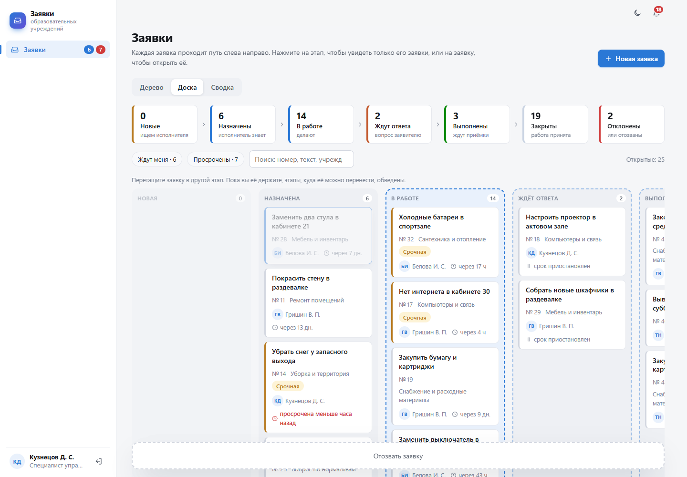
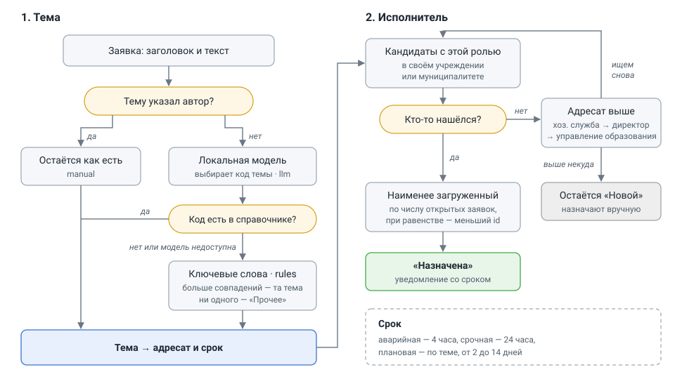
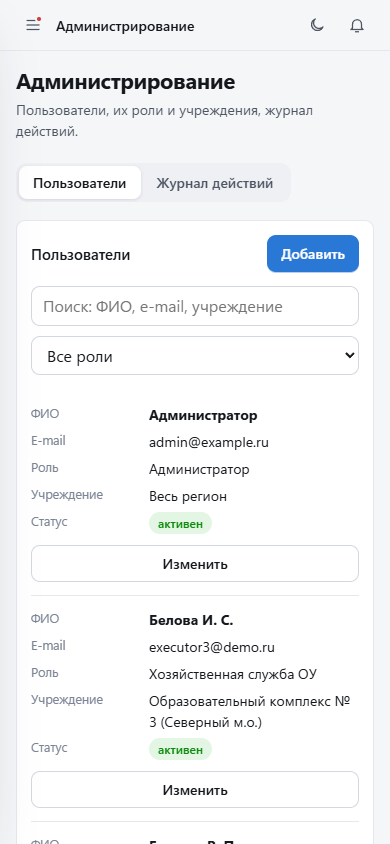

# Заявки ОУ

Система заявок для школ и детских садов. Сотрудник пишет, что нужно сделать
(«починить дверцу шкафа в кабинете 14»), а тема, исполнитель и срок определяются
сами. Дальше заявка идёт по этапам: исполнитель берёт её в работу, задаёт вопросы,
отчитывается, заявитель принимает работу. Сроки, напоминания и вся переписка — в карточке
заявки. На доске заявку можно перетащить мышью в следующий этап.

Администратор заводит пользователей и привязывает их к учреждению: от этого зависит,
чьи заявки человек видит и кому они достаются.

Интерфейс работает и на телефоне. Всё разворачивается в Docker и работает без доступа
в интернет, включая языковую модель.



## Запуск

Нужен Docker с Compose v2.

```bash
cp .env.example .env      # и заменить в нём пароли и ключи
docker compose up -d --build
```

Интерфейс откроется на <http://localhost:8080>, документация API — на
<http://localhost:8080/api/docs>. Если порт занят, поменяйте `APP_PORT` в `.env`.

При первом запуске применяются миграции, создаётся администратор и, если
`SEED_DEMO_DATA=true`, 36 демонстрационных учреждений с корпусами и заявки
за последний месяц: половина учреждений — в пилотном муниципалитете. Данные
синтетические и генерируются с фиксированным зерном, так что от запуска к запуску
получается одно и то же. Названия муниципалитетов задаются в [seed/](seed/README.md).

Учётные записи после первого запуска:

| Роль | Логин | Пароль |
|---|---|---|
| Администратор | значение `ADMIN_EMAIL` | значение `ADMIN_PASSWORD` |
| Региональный аналитик | `analyst@demo.ru` | `demo12345` |
| Специалист управления образования | `municipal@demo.ru` | `demo12345` |
| Директор ОУ | `director@demo.ru` | `demo12345` |
| Наблюдатель | `observer@demo.ru` | `demo12345` |
| Хозяйственная служба ОУ | `executor@demo.ru` | `demo12345` |
| Сотрудник ОУ | `employee@demo.ru` | `demo12345` |

Сотрудник видит свои заявки, хозяйственная служба — адресованные ей в своём
учреждении, директор — все заявки учреждения, специалист — своего муниципалитета,
аналитик и наблюдатель — всего региона. Ограничения проверяются на уровне API.

Демо-пользователи создаются только вместе с демо-данными. Для реальной установки
поставьте `SEED_DEMO_DATA=false` — тогда в базе будет только администратор.

## Локальная модель

Модель нужна для одного: определить тему заявки по свободному тексту. Без неё тема
определяется по ключевым словам, остальная система от модели не зависит. Текст заявки
уходит только в локальную модель — облачные сервисы не поддерживаются, потому что
в заявках бывают фамилии.

Подходит любой сервер с OpenAI-совместимым API. Проверено на Qwen3-8B (Q4_K_M)
в двух вариантах.

**Вариант 1 — модель в Docker.** Положите файл `.gguf` в папку `models/` и добавьте в `.env`:

```dotenv
COMPOSE_PROFILES=llm
LLM_BASE_URL=http://llm:8080/v1
```

После `docker compose up -d` поднимется сервис `llm` на llama.cpp и возьмёт первый
найденный файл (или тот, что указан в `LLM_MODEL_FILE`). В контейнере модель считает
на процессоре.

**Вариант 2 — LM Studio на хосте.** Загрузите модель, включите сервер
(Developer → Start server) и укажите:

```dotenv
LLM_BASE_URL=http://host.docker.internal:1234/v1
LLM_MODEL=qwen3-8b        # идентификатор из http://localhost:1234/v1/models
```

После изменения `.env` перезапустите сервисы: `docker compose up -d`.

### Какую модель брать

Задача у модели простая — выбрать один код темы из списка, поэтому большая модель
не нужна. Для ноутбука уровня Core Ultra 5 125H с 16 ГБ памяти хватит **Qwen3-4B,
Q4_K_M** (около 2,5 ГБ): она оставляет память для Docker и браузера.
`LLM_DISABLE_THINKING=true` выключает у Qwen3 режим рассуждений, который на процессоре
добавляет к ответу лишние секунды.

## Что умеет система

- **Заявки.** Тема, ответственный и срок определяются по тексту. Семь этапов,
  пауза срока, пока исполнитель ждёт ответа, напоминания, автозакрытие принятых.
  Подробнее — ниже.
- **Три вида списка.** Дерево по месту, этапу, исполнителю или теме; доска
  с перетаскиванием между этапами; сводка: поток за 30 дней, темы, нагрузка
  на исполнителей, доля выполненных в срок.
- **Администрирование.** Пользователи, роли и привязка к учреждению или
  муниципалитету, журнал действий.
- **Роли.** Администратор, региональный аналитик, специалист управления образования
  (свой муниципалитет), директор (своё учреждение), наблюдатель (только чтение),
  хозяйственная служба и сотрудник учреждения.
- **Аудит.** Входы, создание и изменение заявок, изменения пользователей.
- **Телефон и планшет.** Меню выезжает по кнопке, этапы и доска листаются пальцем,
  карточка заявки открывается на весь экран, таблицы превращаются в карточки.

Соответствие пунктам ТЗ, включая то, что сделано частично или не сделано, разобрано
в [docs/tz-coverage.md](docs/tz-coverage.md).

## Заявки

Путь типовой заявки «починить дверцу шкафа в кабинете 14»:

1. Сотрудник заполняет одно поле. Тему определяет модель, а без неё — ключевые слова:
   «Мебель и инвентарь».
2. По теме выбираются ответственная служба и срок: аварийная заявка — 4 часа,
   срочная — сутки, плановая — от 2 до 14 дней в зависимости от темы.
3. Исполнителем становится наименее загруженный сотрудник нужной службы в этом
   учреждении. Если службы нет, заявка поднимается к директору, затем в управление
   образования. Статус — «Назначена».
4. Дальше статус меняется от действий, а не вручную: исполнитель ответил — «В работе»;
   задал вопрос заявителю — «Ждёт ответа», срок приостановлен; заявитель ответил —
   снова «В работе», срок сдвинут на время ожидания; исполнитель отчитался —
   «Выполнена»; заявитель принял работу или молчит три дня — «Закрыта».
5. За сутки до срока исполнителю приходит напоминание, о просрочке узнаёт и директор.
   Уведомления видны в интерфейсе, под колокольчиком.

Пока заявку не выполнили, заявитель может её отозвать — без объяснений, в ленте
останется «Отозвана заявителем». Исполнитель отклоняет заявку только с причиной.

Вся история — кто, когда и что сделал — лежит в ленте заявки. Вести заявку могут
исполнитель, ответственная служба и руководитель в пределах своего учреждения или
территории; переназначить её можно только на того, кто вправе работать с заявками
этого учреждения.

### Как выбираются тема и исполнитель



Справочник тем лежит в `services/routing.py`. У каждой темы есть адресат, срок
плановой заявки и набор основ слов для разбора без модели.

**Тема.** Если сотрудник выбрал тему сам, она остаётся как есть. Иначе заголовок
и текст (первые 1500 символов) уходят локальной модели вместе со списком тем, и она
возвращает код темы. Во внешний сервис текст заявки не отправляется ни при каких
настройках: в нём бывают фамилии. Если модель не отвечает или вернула код, которого
нет в справочнике, тема определяется по ключевым словам: текст приводится к нижнему
регистру, «ё» заменяется на «е», и выигрывает тема с наибольшим числом совпадений.
Ни одного совпадения — «Прочее». Чем определена тема (`manual`, `llm` или `rules`),
записывается в заявку.

**Исполнитель** (`services/helpdesk.py`). Кандидаты — активные пользователи с ролью
адресата: хозяйственная служба и директор ищутся в учреждении заявки, специалист —
в его муниципалитете, аналитик и администратор — среди всех. Из них выбирается тот,
у кого меньше открытых заявок (новые, назначенные, в работе, ждут ответа), при
равенстве — заведённый раньше. Если в учреждении нет хозяйственной службы, заявка
уходит директору, нет директора — в управление образования, и адресат в заявке
меняется на того, кто её получил. Если не нашёлся никто, заявка остаётся «Новой»,
а у руководителя она появляется в «Ждут вас» с подсказкой назначить исполнителя.

| Тема | Адресат | Срок плановой |
|---|---|---|
| Мебель и инвентарь | Хозяйственная служба | 7 дней |
| Сантехника и отопление | Хозяйственная служба | 3 дня |
| Электрика и освещение | Хозяйственная служба | 3 дня |
| Ремонт помещений | Хозяйственная служба | 14 дней |
| Уборка и территория | Хозяйственная служба | 2 дня |
| Компьютеры и связь | Хозяйственная служба | 3 дня |
| Снабжение и расходные материалы | Хозяйственная служба | 10 дней |
| Безопасность и доступ | Директор | 3 дня |
| Дополнительные ставки | Управление образования | 14 дней |
| Исправление данных | Управление образования | 5 дней |
| Прочее | Управление образования | 7 дней |
| Сокращение и реорганизация | Региональный аналитик | 14 дней |
| Вопрос по нормативам | Региональный аналитик | 7 дней |
| Работа системы | Администратор | 2 дня |

Тему и вид заявки можно поменять в карточке. Срок при этом пересчитывается от момента
создания, а исполнитель остаётся прежним — если заявка ушла не туда, его нужно
переназначить отдельно.

### Как это выглядит

Страница сделана так, чтобы в ней разобрался человек, который видит её первый раз:

- **Этапы сверху.** Семь плашек — «Новые → Назначены → В работе → Ждут ответа →
  Выполнены → Закрыты» и отдельно «Отклонены». На каждой число и пара слов о том, что
  на этом этапе происходит. Щелчок по плашке оставляет в списке только этот этап.
  По умолчанию закрытые и отклонённые скрыты, чтобы не мешали.
- **Дерево.** Заявки разложены по группам, группу можно раскрыть и свернуть. Группировка
  — по месту (муниципалитет → учреждение → корпус), по этапу, по исполнителю или по теме.
  Уровни, где выбирать не из чего, пропускаются: у директора дерево начинается сразу
  с корпусов. В строке группы — полоска с долями этапов, число заявок, сколько
  просрочено и сколько ждут вас. Наверху всегда то, что просрочено.
- **«Ждут вас».** У каждой заявки система знает, за кем ход: исполнителю — взять
  в работу или отчитаться, заявителю — ответить на вопрос или принять работу,
  руководителю — назначить исполнителя, если его не нашлось. Такие заявки подсвечены,
  под названием написано, что сделать, а в меню рядом с «Заявками» горит синий счётчик
  (красный — просроченные).
- **Доска.** Пять колонок по этапам. Заявку можно перетащить мышью в другой этап:
  пока её держите, обведены колонки, куда её вправе перенести именно вы, остальные
  бледнеют. Внизу экрана в это время появляются «Закрыть» и «Отклонить», если они
  доступны. Переходы, которым нужно объяснение, — вопрос заявителю, отказ, возврат
  на доработку — открывают окно для текста; при отчёте о выполнении текст можно
  не писать. Права те же, что у кнопок в карточке, и проверяет их сервер.
  В «Назначена» перетащить нельзя: туда заявка попадает, когда ей выбирают исполнителя.
- **Карточка.** Сверху путь заявки по шагам и одна фраза, что сейчас происходит.
  Внизу кнопки только тех действий, которые доступны именно вам, и синей из них
  будет одна — обычный следующий шаг. Если для действия нужна причина, а поле
  пустое, карточка подскажет, что написать.

Сотрудник и хозяйственная служба видят только этапы и дерево, без сводки и доски:
заявок у них немного, а лишние вкладки только сбивают.

Кадровые вопросы («нужна ставка логопеда», «неверно указана площадь корпуса») идут
тем же путём, только адресат у них — управление образования или региональный аналитик.

## Администрирование



Раздел видит только администратор. В нём две вкладки.

- **Пользователи.** Список с поиском по ФИО, e-mail и учреждению и фильтром по роли.
  В строке видно, к какому учреждению или муниципалитету привязан человек.
- **Журнал действий.** Последние 300 записей: кто, когда, что сделал, с какого адреса.

Привязка зависит от роли:

| Роль | Что указать | Какие заявки видит |
|---|---|---|
| Сотрудник, хозяйственная служба, директор | учреждение | своего учреждения |
| Специалист управления образования | муниципалитет | всех учреждений муниципалитета |
| Администратор, аналитик, наблюдатель | ничего | всего региона |

Учреждений в регионе сотни, поэтому в форме пользователя над списком есть поиск
по названию или номеру, а сам список разбит по муниципалитетам. Если под поиск
подходит одно учреждение, оно выбирается сразу. Сервер проверяет, что учреждение
существует и что для роли указана нужная привязка.

После переноса в другое учреждение пользователь сразу работает с его заявками.
Заявки, которые он уже ведёт, остаются за ним — при необходимости их переназначают
в карточке.

## Устройство

```
web      nginx: статика интерфейса и прокси на /api
api      FastAPI: REST, заявки, RBAC, аудит
worker   напоминания о сроках заявок и их автозакрытие
db       PostgreSQL 16 (образ с pgvector: расширение создаёт первая миграция)
backup   ежедневный pg_dump в ./backups
llm      llama.cpp с моделью из ./models (профиль llm)
```

Бэкенд — один сервис: `api` не хранит состояния и масштабируется числом экземпляров,
а фоновые задачи вынесены в `worker`, чтобы напоминания не дублировались.

```
backend/app/
  api/         маршруты
  services/    заявки (helpdesk.py), темы (routing.py), модель (llm.py)
  models.py    схема данных
  seed.py      администратор и генератор демо-данных
backend/alembic/   миграции
frontend/src/      React + TypeScript
seed/              профиль демо-данных: муниципалитеты
scripts/           резервное копирование, запуск модели
```

Интерфейс — React без UI-библиотеки: стили, иконки и перетаскивание на доске свои
(на HTML5 drag and drop), графики на recharts. Есть светлая и тёмная тема. Шрифты
и иконки не подгружаются из сети. Вёрстка проверена на ширине 390, 820 и 1440 px.

## Безопасность

Сделано в приложении: вход по паролю (bcrypt) и JWT, разграничение доступа по ролям
и территории на уровне API, журнал действий, только локальная модель для текста
заявок, база данных без выхода наружу.

Остаётся на стороне инфраструктуры и до ввода в эксплуатацию обязательно:

- **TLS.** Контейнер `web` отдаёт HTTP. Перед ним нужен обратный прокси с TLS 1.3
  и сертификатом организации.
- **Шифрование данных в покое.** Том `pgdata` и каталог `backups`
  должны лежать на зашифрованном разделе (LUKS, BitLocker). В самой СУБД
  шифрование не включено.
- **Секреты.** `SECRET_KEY` и пароли из `.env` — в хранилище секретов.
- **Вход.** Нет SSO и второго фактора; пароли задаёт администратор.

## Резервные копии

Сервис `backup` раз в сутки снимает дамп в `./backups` и удаляет копии старше
`BACKUP_KEEP_DAYS` дней. Восстановление:

```bash
docker compose stop api worker
docker compose exec -T db pg_restore -U hr -d hr_edu --clean --if-exists < backups/<файл>.dump
docker compose start api worker
```

## Разработка

```bash
# база и API на localhost (порты 54320 и 8000)
docker compose -f docker-compose.yml -f docker-compose.dev.yml up -d

# бэкенд
cd backend
python -m venv .venv && . .venv/bin/activate      # в Windows: .venv\Scripts\activate
pip install -e ".[dev]"
ruff check .
pytest                                            # юнит-тесты, база не нужна
TEST_DATABASE_URL=postgresql+psycopg://hr:<пароль>@127.0.0.1:54320/hr_edu_test pytest

# фронтенд
cd frontend
npm install
npm run dev        # http://localhost:5173, запросы /api идут на localhost:8000
```

Тесты API создают отдельную базу `hr_edu_test` и рабочую не трогают. В адресе
указывайте `127.0.0.1`, а не `localhost`: на Windows из-за попыток соединиться
по IPv6 прогон занимает минуты вместо секунд.

После изменения моделей:

```bash
docker compose exec api alembic revision --autogenerate -m "описание"
```

## Ограничения

- Учреждения и корпуса в интерфейсе не заводятся: они приходят из демо-данных или
  вносятся в базу. Администратор только привязывает к ним пользователей.
- Сроки заявок считаются в календарных часах и днях, без выходных и графика работы.
- К заявке нельзя приложить фото.
- Перетаскивание на доске работает мышью. На телефоне и планшете этап меняется
  кнопками в карточке заявки, и доска там показывает только непустые этапы.
- Заявка сохраняется после ответа модели. На процессоре это несколько секунд, а если
  модель зависла — до `LLM_TIMEOUT_S`, после чего тема берётся по ключевым словам.
