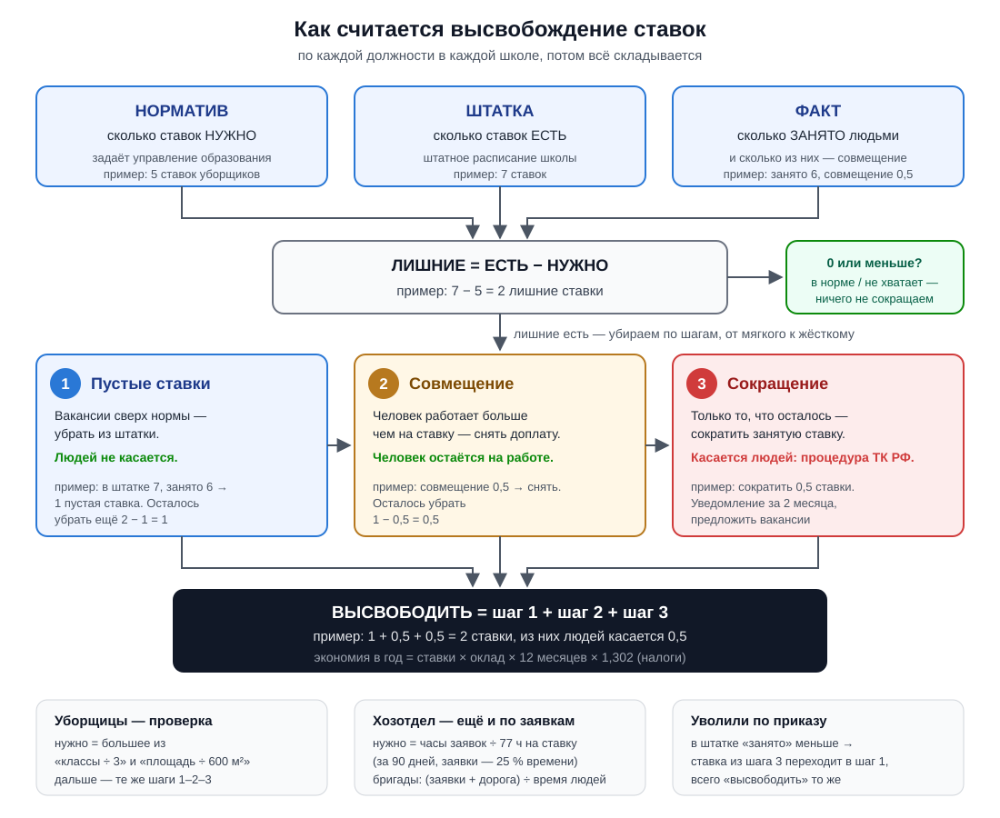
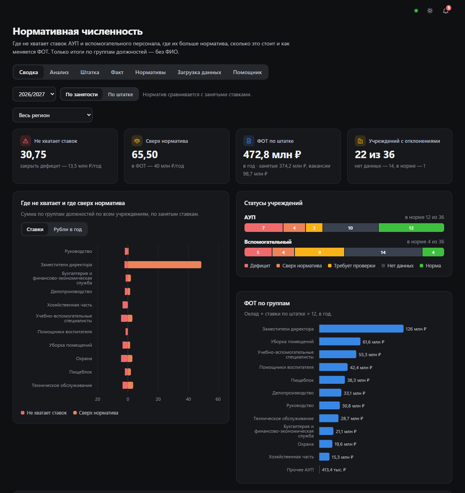
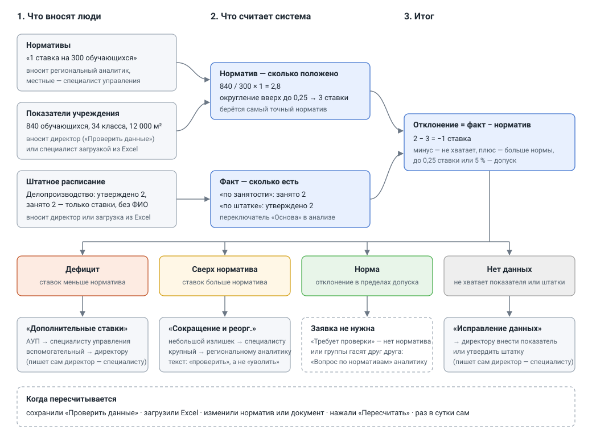

# Заявки ОУ

Система заявок для школ и детских садов. Сотрудник пишет, что нужно сделать
(«починить дверцу шкафа в кабинете 14»), а тема, исполнитель и срок определяются
сами. Дальше заявка идёт по этапам: исполнитель берёт её в работу, задаёт вопросы,
отчитывается, заявитель принимает работу. Сроки, напоминания и вся переписка — в карточке
заявки. На доске заявку можно перетащить мышью в следующий этап.

Администратор заводит пользователей и привязывает их к учреждению: от этого зависит,
чьи заявки человек видит и кому они достаются.

Интерфейс работает и на телефоне. Всё разворачивается в Docker и работает без доступа
в интернет, включая языковую модель.


Руководство для пользователей раздела «Оптимизация штата» — что к чему относится, как
считается, разбор вкладок на живых примерах со скриншотами: [docs/guide.md](docs/guide.md).

## Запуск

Нужен Docker с Compose v2.

```bash
cp .env.example .env      # и заменить в нём пароли и ключи
docker compose up -d --build
```

Интерфейс откроется на <http://localhost:8080>, документация API — на
<http://localhost:8080/api/docs>. Если порт занят, поменяйте `APP_PORT` в `.env`.

При первом запуске применяются миграции, создаётся администратор и, если
`SEED_DEMO_DATA=true`, 36 демонстрационных учреждений с корпусами и заявки
за последний месяц: половина учреждений — в пилотном муниципалитете. Данные
синтетические и генерируются с фиксированным зерном, так что от запуска к запуску
получается одно и то же. Названия муниципалитетов задаются в [seed/](seed/README.md).

Учётные записи после первого запуска:

| Роль | Логин | Пароль |
|---|---|---|
| Администратор | значение `ADMIN_EMAIL` | значение `ADMIN_PASSWORD` |
| Региональный аналитик | `analyst@demo.ru` | `demo12345` |
| Специалист управления образования | `municipal@demo.ru` | `demo12345` |
| Директор ОУ | `director@demo.ru` | `demo12345` |
| Наблюдатель | `observer@demo.ru` | `demo12345` |
| Хозяйственная служба ОУ | `executor@demo.ru` | `demo12345` |
| Сотрудник ОУ | `employee@demo.ru` | `demo12345` |

Сотрудник видит свои заявки, хозяйственная служба — адресованные ей в своём
учреждении, директор — все заявки учреждения, специалист — своего муниципалитета,
аналитик и наблюдатель — всего региона. Ограничения проверяются на уровне API.

Демо-пользователи создаются только вместе с демо-данными. Для реальной установки
поставьте `SEED_DEMO_DATA=false` — тогда в базе будет только администратор.

## Локальная модель

Модель определяет тему заявки по свободному тексту и отвечает в чате помощника по
штатке. Без неё тема определяется по ключевым словам, а помощник недоступен; остальная
система от модели не зависит. Текст заявки
уходит только в локальную модель — облачные сервисы не поддерживаются, потому что
в заявках бывают фамилии.

Подходит любой сервер с OpenAI-совместимым API. Проверено на Qwen3-8B (Q4_K_M)
в двух вариантах.

**Вариант 1 — модель в Docker.** Положите файл `.gguf` в папку `models/` и добавьте в `.env`:

```dotenv
COMPOSE_PROFILES=llm
LLM_BASE_URL=http://llm:8080/v1
```

После `docker compose up -d` поднимется сервис `llm` на llama.cpp и возьмёт первый
найденный файл (или тот, что указан в `LLM_MODEL_FILE`). В контейнере модель считает
на процессоре.

**Вариант 2 — LM Studio на хосте.** Загрузите модель, включите сервер
(Developer → Start server) и укажите:

```dotenv
LLM_BASE_URL=http://host.docker.internal:1234/v1
LLM_MODEL=qwen3-8b        # идентификатор из http://localhost:1234/v1/models
```

После изменения `.env` перезапустите сервисы: `docker compose up -d`.

### Какую модель брать

Задача у модели простая — выбрать один код темы из списка, поэтому большая модель
не нужна. Для ноутбука уровня Core Ultra 5 125H с 16 ГБ памяти хватит **Qwen3-4B,
Q4_K_M** (около 2,5 ГБ): она оставляет память для Docker и браузера.
`LLM_DISABLE_THINKING=true` выключает у Qwen3 режим рассуждений, который на процессоре
добавляет к ответу лишние секунды.

### Если модель выключена или не работает

API и worker раз в `LLM_CHECK_INTERVAL_S` секунд (по умолчанию 60) спрашивают у сервера
модели `GET /v1/models`: отвечает ли он и есть ли на нём модель из `LLM_MODEL`. Сбоем
считается и неудачный запрос при разборе заявки.

- **Администратор** видит над страницей предупреждение с причиной и кнопкой «Проверить
  сейчас», а под колокольчиком — уведомление, когда модель пропала и когда вернулась.
  Если `LLM_BASE_URL` не задан, предупреждение говорит, что модель не подключена.
- **Тот, кто создаёт заявку**, видит в форме, что тема будет определена по ключевым
  словам, и может выбрать её сам.
- **Заявки не ждут модель.** После сбоя запросы к ней не идут, пока проверка не скажет,
  что она снова отвечает: тема сразу берётся по ключевым словам, а не после
  `LLM_TIMEOUT_S`.

Состояние модели: `GET /api/llm/status` (подробности — только администратору),
`/api/health` (поле `llm_available`).

## Что умеет система

- **Заявки.** Тема, ответственный и срок определяются по тексту. Семь этапов,
  пауза срока, пока исполнитель ждёт ответа, напоминания, автозакрытие принятых.
  Подробнее — ниже.
- **Три вида списка.** Дерево по месту, этапу, исполнителю или теме; доска
  с перетаскиванием между этапами; сводка: поток за 30 дней, темы, нагрузка
  на исполнителей, доля выполненных в срок.
- **Администрирование.** Пользователи, роли и привязка к учреждению или
  муниципалитету, журнал действий.
- **Роли.** Администратор, региональный аналитик, специалист управления образования
  (свой муниципалитет), директор (своё учреждение), наблюдатель (только чтение),
  хозяйственная служба и сотрудник учреждения.
- **Аудит.** Входы, создание и изменение заявок, изменения пользователей.
- **Телефон и планшет.** Меню выезжает по кнопке, этапы и доска листаются пальцем,
  карточка заявки открывается на весь экран, таблицы превращаются в карточки.

Соответствие пунктам ТЗ, включая то, что сделано частично или не сделано, разобрано
в [docs/tz-coverage.md](docs/tz-coverage.md).

## Заявки

Путь типовой заявки «починить дверцу шкафа в кабинете 14»:

1. Сотрудник заполняет одно поле. Тему определяет модель, а без неё — ключевые слова:
   «Мебель и инвентарь».
2. По теме выбираются ответственная служба и срок: аварийная заявка — 4 часа,
   срочная — сутки, плановая — от 2 до 14 дней в зависимости от темы.
3. Исполнителем становится наименее загруженный сотрудник нужной службы в этом
   учреждении. Если службы нет, заявка поднимается к директору, затем в управление
   образования. Статус — «Назначена».
4. Дальше статус меняется от действий, а не вручную: исполнитель ответил — «В работе»;
   задал вопрос заявителю — «Ждёт ответа», срок приостановлен; заявитель ответил —
   снова «В работе», срок сдвинут на время ожидания; исполнитель отчитался —
   «Выполнена»; заявитель принял работу или молчит три дня — «Закрыта».
5. За сутки до срока исполнителю приходит напоминание, о просрочке узнаёт и директор.
   Уведомления видны в интерфейсе, под колокольчиком.

Пока заявку не выполнили, заявитель может её отозвать — без объяснений, в ленте
останется «Отозвана заявителем». Исполнитель отклоняет заявку только с причиной.

Переназначение тоже двигает статус: новый исполнитель сам берёт заявку в работу, поэтому
заявка «в работе» после передачи снова «назначена». Если исполнителя сняли и
бригады нет, заявка возвращается в «новые», и у руководителя она появляется в «Ждут
вас». Выполненную заявку не переназначают — её принимают или возвращают на доработку,
закрытую и отклонённую не меняют вовсе.

У крупной заявки, разбитой на этапы, общая заявка выполнена, когда выполнены все этапы;
вручную отметить её выполненной раньше нельзя. Этап вернули на доработку — общая заявка
снова «в работе». Отклонили общую — открытые этапы отклоняются вместе с ней.

### Обновления в реальном времени

Список, доска, карточка заявки, счётчики в меню и колокольчик обновляются сами, как
только кто-то меняет заявку: перезагружать страницу не нужно. Если карточка открыта,
а статус поменял другой человек, в ней появится строка о том, что изменилось.
Зелёная точка в шапке — связь есть; серая с надписью «нет связи» — интерфейс
переподключается и после этого перечитает данные.

Как это устроено: при фиксации транзакции с изменением заявки PostgreSQL получает
`NOTIFY` с её номером (`services/live.py`), каждый экземпляр API слушает канал и
отправляет событие в поток `GET /api/events` (Server-Sent Events) тем, кто вправе видеть
заявку. В событии только номера, сами заявки интерфейс перечитывает обычными
запросами с проверкой прав (`GET /api/requests?ids=…`). Так изменения из worker и любого
экземпляра API доходят до всех без отдельного брокера.

Вся история — кто, когда и что сделал — лежит в ленте заявки. Вести заявку могут
исполнитель, ответственная служба и руководитель в пределах своего учреждения или
территории; переназначить её можно только на того, кто вправе работать с заявками
этого учреждения.

### Как выбираются тема и исполнитель


Справочник тем лежит в `services/routing.py`. У каждой темы есть адресат, срок
плановой заявки и набор основ слов для разбора без модели.

**Тема.** Если сотрудник выбрал тему сам, она остаётся как есть. Иначе заголовок
и текст (первые 1500 символов) уходят локальной модели вместе со списком тем, и она
возвращает код темы. Во внешний сервис текст заявки не отправляется ни при каких
настройках: в нём бывают фамилии. Если модель не отвечает или вернула код, которого
нет в справочнике, тема определяется по ключевым словам: текст приводится к нижнему
регистру, «ё» заменяется на «е», и выигрывает тема с наибольшим числом совпадений.
Ни одного совпадения — «Прочее». Чем определена тема (`manual`, `llm` или `rules`),
записывается в заявку.

**Исполнитель** (`services/helpdesk.py`). Кандидаты — активные пользователи с ролью
адресата: хозяйственная служба и директор ищутся в учреждении заявки, специалист —
в его муниципалитете, аналитик и администратор — среди всех. Из них выбирается тот,
у кого меньше открытых заявок (новые, назначенные, в работе, ждут ответа), при
равенстве — заведённый раньше. Если в учреждении нет хозяйственной службы, заявка
уходит директору, нет директора — в управление образования, и адресат в заявке
меняется на того, кто её получил. Если не нашёлся никто, заявка остаётся «Новой»,
а у руководителя она появляется в «Ждут вас» с подсказкой назначить исполнителя.

| Тема | Адресат | Срок плановой |
|---|---|---|
| Мебель и инвентарь | Хозяйственная служба | 7 дней |
| Сантехника и отопление | Хозяйственная служба | 3 дня |
| Электрика и освещение | Хозяйственная служба | 3 дня |
| Ремонт помещений | Хозяйственная служба | 14 дней |
| Уборка и территория | Хозяйственная служба | 2 дня |
| Компьютеры и связь | Хозяйственная служба | 3 дня |
| Снабжение и расходные материалы | Хозяйственная служба | 10 дней |
| Безопасность и доступ | Директор | 3 дня |
| Дополнительные ставки | Управление образования | 14 дней |
| Исправление данных | Управление образования | 5 дней |
| Прочее | Управление образования | 7 дней |
| Сокращение и реорганизация | Региональный аналитик | 14 дней |
| Вопрос по нормативам | Региональный аналитик | 7 дней |
| Работа системы | Администратор | 2 дня |

Тему и вид заявки можно поменять в карточке. Срок при этом пересчитывается от момента
создания, а исполнитель остаётся прежним — если заявка ушла не туда, его нужно
переназначить отдельно.

### Как это выглядит

Страница сделана так, чтобы в ней разобрался человек, который видит её первый раз:

- **Этапы сверху.** Семь плашек — «Новые → Назначены → В работе → Ждут ответа →
  Выполнены → Закрыты» и отдельно «Отклонены». На каждой число и пара слов о том, что
  на этом этапе происходит. Щелчок по плашке оставляет в списке только этот этап.
  По умолчанию закрытые и отклонённые скрыты, чтобы не мешали.
- **Дерево.** Заявки разложены по группам, группу можно раскрыть и свернуть. Группировка
  — по месту (муниципалитет → учреждение → корпус), по этапу, по исполнителю или по теме.
  Уровни, где выбирать не из чего, пропускаются: у директора дерево начинается сразу
  с корпусов. В строке группы — полоска с долями этапов, число заявок, сколько
  просрочено и сколько ждут вас. Наверху всегда то, что просрочено.
- **«Ждут вас».** У каждой заявки система знает, за кем ход: исполнителю — взять
  в работу или отчитаться, заявителю — ответить на вопрос или принять работу,
  руководителю — назначить исполнителя, если его не нашлось. Такие заявки подсвечены,
  под названием написано, что сделать, а в меню рядом с «Заявками» горит синий счётчик
  (красный — просроченные).
- **Доска.** Пять колонок по этапам. Заявку можно перетащить мышью в другой этап:
  пока её держите, обведены колонки, куда её вправе перенести именно вы, остальные
  бледнеют. Внизу экрана в это время появляются «Закрыть» и «Отклонить», если они
  доступны. Переходы, которым нужно объяснение, — вопрос заявителю, отказ, возврат
  на доработку — открывают окно для текста; при отчёте о выполнении текст можно
  не писать. Права те же, что у кнопок в карточке, и проверяет их сервер.
  В «Назначена» перетащить нельзя: туда заявка попадает, когда ей выбирают исполнителя.
- **Карточка.** Сверху путь заявки по шагам и одна фраза, что сейчас происходит.
  Внизу кнопки только тех действий, которые доступны именно вам, и синей из них
  будет одна — обычный следующий шаг. Если для действия нужна причина, а поле
  пустое, карточка подскажет, что написать.

Сотрудник и хозяйственная служба видят только этапы и дерево, без сводки и доски:
заявок у них немного, а лишние вкладки только сбивают.

Кадровые вопросы («нужна ставка логопеда», «неверно указана площадь корпуса») идут
тем же путём, только адресат у них — управление образования или региональный аналитик.

## Как считается высвобождение — по шагам

Самое короткое объяснение того, как система приходит к цифре «высвободить N ставок».
Подробности с правилами — в разделе «Алгоритм» ниже, пользовательское руководство со
скриншотами — в [docs/guide.md](docs/guide.md).



### Три числа на каждую должность

По каждой должности в каждой школе система берёт три числа:

| Число | Вопрос | Откуда |
|---|---|---|
| **Нужно** | Сколько ставок положено? | Норматив управления образования: «1 ставка на 600 м²», «1 директор на школу» |
| **Есть** | Сколько ставок записано в штатке? | Штатное расписание школы |
| **Занято** | Сколько из них реально занято людьми, и сколько из занятого — совмещение? | Та же штатка, столбцы «занято» и «совмещение» |

Если «есть» не больше «нужно» — должность в норме (или ставок не хватает), высвобождать
нечего. Если больше — лишнее убирается в три шага, всегда в одном порядке.

### Пример целиком

Уборщики в школе: нужно **5**, в штатке **7**, занято **6**, из занятых **0,5** — совмещение
(кто-то из уборщиц работает на полторы ставки).

| Шаг | Что делаем | Сколько | Осталось убрать |
|---|---|---|---|
| — | Лишние = есть − нужно = 7 − 5 | 2 | 2 |
| 1 | Пустые ставки: в штатке 7, занято 6 — одна ставка пустая. Убираем из штатки, никого не трогаем | 1 | 1 |
| 2 | Совмещение: снимаем 0,5 ставки доплаты, уборщица остаётся на своей ставке | 0,5 | 0,5 |
| 3 | Остаток — сокращаем 0,5 занятой ставки, по процедуре ТК РФ | 0,5 | 0 |
| | **Высвободить** | **2** | людей касается только 0,5 |

После этого в штатке ровно 5 ставок, пустых нет. Экономия — 2 ставки × оклад × 12 месяцев
× 1,302 (налоги).

Если бы все 7 ставок были заняты без совмещений, шаги 1 и 2 дали бы 0, и сократить
пришлось бы 2 занятые ставки. Если бы занято было 5 — убрали бы 2 пустые ставки, и никого
не увольняли бы.

### Итог по округу

Так считается каждая должность каждой школы, потом всё складывается. Например:

```
вакансии (шаг 1)        90,5
совмещение (шаг 2)    + 115
сокращение (шаг 3)    +  11      ← людей касается только это
──────────────────────────────
высвободить           = 216,5 ставки
```

### Уборщицы

Кроме общего норматива есть простая проверка по двум числам школы: классы и площадь.
Нужно = **большее** из «классы ÷ 3» и «площадь ÷ 600 м²» — убрать надо и все классы, и всю
площадь. Пример — школа на 44 класса и 12 750 м²:

```
44 класса ÷ 3        = 14,67
12 750 м² ÷ 600      = 21,25   ← большее, это и нужно
есть 23 ставки       → лишние 23 − 21,25 = 1,75
```

Как именно убрать эти 1,75 — решают те же шаги 1–2–3: сначала пустые ставки уборщиц,
потом совмещение, потом занятые ставки.

### Хозотдел

Хозотдел проверяется дважды: по нормативу (как все, шаги 1–2–3) и по реальной работе —
заявкам. Заявки — это не вся работа: обходы, плановые и сезонные работы идут без заявок,
поэтому на заявки отводится 25 % времени.

```
одна ставка за 90 дней    = 64,3 рабочих дня × 6 ч           = 386 ч
из них на заявки          = 386 × 25 %                       = 96 ч
при нормальной загрузке   = 96 × 80 %                        ≈ 77 ч заявок на ставку

школа: 176 заявок за 90 дней       = 655 ч
нужно                     = 655 ÷ 77                         ≈ 8,5 ставки
есть 8,75                 → лишние 0,25
```

У **бригады управления** вся работа — заявки плюс дорога до школ:

```
бригада: 3 человека, 26 школ, 52 выезда за 90 дней
может отработать          = 3 × 386 ч                        = 1 158 ч
пришло работы             = 892 ч + 34 ч дороги              = 926 ч
загрузка                  = 926 ÷ 1 158                      = 80 % — норма
```

Ниже 80 % — люди простаивают («лишние»), выше 100 % — не успевают. В карточке бригады
и хозотдела школы (вкладка «Хозотдел», нажать на строку) этот расчёт расписан по шагам,
с людьми, школами и последними заявками.

### Увольнение по приказу

Когда приказ об увольнении внесён на вкладке «Уволенные», ставка уволенного в штатке
становится пустой: «занято» уменьшается. Значит, в следующий раз эта ставка уйдёт не на
шаге 3 (сокращение), а на шаге 1 (пустая ставка):

| | До приказа | После |
|---|---|---|
| В штатке / занято | 7 / 7 | 7 / 6 |
| Шаг 1 — пустые ставки | 0 | 1 |
| Шаг 3 — сокращение | 2 | 1 |
| Высвободить всего | 2 | 2 |

Всего «высвободить» не меняется: пустую ставку всё равно надо убрать из штатки. Меняется
то, сколько ещё касается людей.

## Оптимизация штата

Раздел для программ оптимизации штатных расписаний школ. Система анализирует штатку
каждой школы и говорит, где **убрать вакансии**, где **уменьшить нагрузку** (снять
совмещение) и где **сократить занятые ставки**, сколько это экономит фонда оплаты труда
и рабочих часов. Если загружен расчёт управления образования, итог сверяется с ним: по
округу, по школам и по должностям.

Данные программы — файл `seed/program.local.json` (в git не попадает: в нём ФИО из
приказов). Его можно перенести между установками вместе с базой — см. «Перенос данных».
В файле:

- `program` — итоги расчёта управления: всего, вакансии, нагрузка, увольнения, штатные
  единицы, ФОТ, цель по экономии, реквизиты документа-основания;
- `schools` и `positions` — высвобождение по школам и по должностям из расчёта;
- `dismissals` — приказы об увольнении (школа, ФИО, должность, ставка, основание, приказ);
- `fill` — как заполнить школы под расчёт, если их штатки ещё не загружены.

По `fill` при первом запуске собирается:

- штатка «до» по должностям — итоги по должностям раскладываются по школам
  пропорционально размеру школы так, что сходятся и итоги школ, и итоги должностей;
- норматив — целевая штатка «после» по каждой школе и должности;
- совмещение — та часть высвобождения, что в расчёте записана как «уменьшение нагрузки»;
- показатели школ (число обучающихся, классы, площадь) и заявки хозотдела за 90 дней —
  так, чтобы расчёт уборщиц и загрузка хозотдела подтверждали расчёт;
- `extra_schools` — школы, которых нет в расчёте: штатка у них ровно по нормативу, итог
  они не меняют, но видны в списках, заявках и дашбордах;
- `brigades` — бригады управления: база, закреплённые школы, сотрудники, выезды.

Заполнение помечено версией: при её смене штатки школ, нормативы, заявки-заполнение
пересоздаются при следующем запуске API, а приказы сверяются с файлом. Остальное в базе
не трогается. Когда школа загрузит свою настоящую штатку, анализ пересчитается по ней.

| Вкладка | Что видно |
|---|---|
| **Итог** | Сколько можно высвободить и тремя способами; сверка с расчётом УО (✓); уборщицы, хозотдел, остальные; таблица «Где высвобождать» по школам; какие должности. Директору — «Что сделать» по своей школе |
| **Должности** | Было → вакансии, нагрузка, люди → стало, экономия; рядом — цифра расчёта УО |
| **Уборщицы** | Нужно = большее из «классы ÷ 3» и «площадь ÷ 600 м²» |
| **Хозотдел** | Свой хозотдел — по заявкам школы; бригады управления — по всем своим школам (заявки + дорога). Нажмите на школу или бригаду — карточка: кто работает, какие школы и выезды, что чинили, последние заявки и расчёт по шагам |
| **Штатка** | Штатка школы по должностям: по штатке, занято, совмещение, вакансии и что высвободить |
| **Уволенные** | Приказы по школам: кто, должность, ставка, основание, № и дата приказа. Увольнение учитывается в штатке школы (см. ниже). Сверка «в расчёте УО ↔ по приказам». Добавлять, править и удалять может управление и администратор |
| **Почему так — ИИ** | Локальная модель объясняет расчёт: почему, откуда цифра, как это делается и что дальше с сотрудником. Можно выбрать школу и должность |

Фамилии и приказы — только на вкладке «Уволенные». На «Итоге» и в разъяснениях видно
только, сколько ставок нужно высвободить и каким способом.

### Алгоритм: как система решает, что высвобождать

**Что на входе.**

| Данные | Кто ведёт | Пример |
|---|---|---|
| **Норматив** — сколько ставок положено по должности (группе должностей) | Управление образования (региональные — аналитик) | фиксированно: «1 директор на школу»; от показателя: «1 ставка уборщика на 600 м²», «1 заместитель на 300 учеников», с порогами и минимумом |
| **Показатели школы** — от чего считается норматив | Директор или управление | 44 класса, 1 100 учеников, 12 750 м² |
| **Штатное расписание** — сколько ставок по каждой должности | Директор или загрузка из Excel | «Уборщик — 7 ставок» |
| **Факт** — сколько из этих ставок занято людьми и сколько из занятых — совмещение | Там же, в штатке | «занято 6, из них совмещение 0,5» |
| **Заявки** — сколько работы реально приходит хозотделу и бригадам | Заявки школ | 176 заявок за 90 дней, 655 ч |
| **Приказы об увольнении** | Управление | «Уборщик, 1 ставка, приказ № 95/2-к» |

**Шаг 1. Норматив.** По показателям школы считается, сколько ставок нужно по каждой группе
должностей: 12 750 м² ÷ 600 = 21,25 ставки уборщиков. Округление и допуск заданы в
нормативе.

**Шаг 2. Сравнение.** По каждой группе: «занято» против норматива и «по штатке» против
норматива. Расхождение до 0,25 ставки или 5 % — норма. Ставок меньше норматива — «не
хватает», сокращать нельзя.

**Шаг 3. Что делать с лишним** — всегда в одном порядке, от мягкого к жёсткому:

1. **Вакансии.** Ставки по штатке, которые не заняты и сверх норматива, — убрать из штатки.
   Людей это не касается. Вакансии, которые нужны до нормы, остаются: их надо заполнить.
2. **Совмещение.** Если занятых ставок больше нормы, сначала снимается совмещение и
   дополнительная нагрузка: человек остаётся на своей ставке, уходит доплата.
3. **Сокращение занятых ставок** — только остаток после первых двух шагов.

Важно: **«в штатке больше ставок, чем в нормативе» — не значит «уволить»**. Увольнение
касается только третьего шага. Пример — норматив 5 ставок уборщиков, в штатке 7:

| Факт | Что скажет система | Кого увольнять |
|---|---|---|
| Занято 5, вакантно 2 | Убрать 2 вакансии из штатки | Никого |
| Занято 6, вакантно 1 | Убрать 1 вакансию, сократить 1 занятую ставку | Одного |
| Занято 7, из них совмещение 1 | Снять совмещение 1, сократить 1 занятую ставку | Одного |
| Занято 7, совмещений нет | Сократить 2 занятые ставки | Двоих |
| Занято 4, вакантно 3 | Убрать 2 вакансии, одну заполнить | Никого, наоборот — нанять |

После всех шагов в штатке остаётся ровно норматив — 5 ставок, без лишних вакансий.

Решение принимается по группе, а сокращение раскладывается по конкретным должностям:
вакансии — где они есть, совмещение — где оно есть, занятые ставки — с самой многочисленной
должности группы. Экономия = ставки × оклад × 12 (на «Итоге» — с налогами).

**Уборщицы.** Считаются в том же общем алгоритме (группа «Уборщики» на «Итоге» и
«Должностях»: вакансии → совмещение → люди). Вкладка «Уборщицы» — дополнительная простая
проверка без штатки по должностям: нужно = большее из «классы ÷ 3» и «площадь ÷ 600 м²»,
сравнивается со ставками уборщиц школы. Она показывает, где уборщиц больше или меньше, чем
нужно, но кого именно и как высвобождать — решает общий алгоритм по штатке и факту.

**Хозотдел** проверяется в два этапа.

1. *По нормативу* — как любая группа: норматив (по площади, зданиям) против штатки и факта,
   затем вакансии → совмещение → люди.
2. *По заявкам* — сколько работы реально приходит:
   - часы своего хозотдела = сумма трудоёмкости заявок школы за период; заявки — только часть
     рабочего времени (по умолчанию 25 %, остальное — плановые обходы, сезонные и
     регламентные работы), поэтому работа = часы заявок ÷ 25 %;
   - нужно людей = работа ÷ (рабочие дни × 6 ч × 80 % нормальной загрузки), но не меньше 1;
   - если **все** сотрудники хозотдела заведены в системе и работы мало — можно сократить
     больше, чем говорит норматив («по загрузке»);
   - если заявок много — сокращать не больше, чем позволяет загрузка, даже если по нормативу
     лишние;
   - если заведены не все — загрузка только показывается: по ней не видна вся работа.
3. *Бригады управления* — отдельно: работа = все заявки бригады по закреплённым школам
   плюс дорога (каждый выезд — 2 × расстояние от базы ÷ 30 км/ч); нужно людей = (работа +
   дорога) ÷ (рабочие дни × 6 ч × 80 %), вверх до 0,5. Лишние — первыми в списке наименее
   загруженные. Это подсказка руководителю, в штатку школ бригады не входят.

**Увольнение по приказу.** Запись на вкладке «Уволенные» с флажком «учесть в штатке»
уменьшает «занято» в строке этой должности в штатке школы — ставка становится вакантной
(в истории штатки появляется версия «увольнение по приказу»). На «Итоге» эта ставка
переходит из «сократить занятые ставки» в «убрать вакансии», число штатных единиц к
сокращению уменьшается. Всего «высвободить» не меняется: ставку всё равно нужно убрать из
штатки. Удаление записи или кнопка «Вернуть» возвращает ставку. Записи, загруженные из
документов управления, в штатке не учтены — анализ показывает состояние до этих
увольнений; кнопка «Учесть в штатке» применяет запись.

Разъяснения идут потоком: справка для модели короткая (итог, школа, должность, порядок
высвобождения, общие нормы ТК РФ), а правила стоят в начале промпта и кешируются сервером
модели. Пока вкладка открыта, справка по выбранной школе и должности заранее отправляется
модели (прогрев), поэтому на qwen3-8b в LM Studio первые слова появляются через 1–2 секунды.

## Штатка и нормативы (подробный анализ)

Раздел отвечает на главный вопрос: **сколько ставок лишние и что можно сократить** —
в первую очередь уборщиков и хозяйственный отдел. Для этого он сравнивает, сколько
ставок **положено** по нормативу, со сколькими **есть** в штатке, а для хозотдела
и бригад ещё и смотрит, сколько работы реально приходит заявками.

Вкладки:

Система может работать в одном округе — ключ `okrug` в профиле `seed/local.json`
(см. `seed/README.md`).

| Вкладка | Что показывает |
|---|---|
| **Итог** | Крупно: «можно сократить N ставок, ≈ X ₽ в год, Y % ФОТ» — отдельно занятые ставки (люди лишние) и вакантные (увольнять никого). Директору — список «Что сделать» по порядку экономии: какую должность и сколько ставок, с кнопкой «Почему» и всем расчётом; карточки уборщиков, хозотдела и ФОТ; полосы «положено / есть» по группам. Управлению — топ школ, какие должности сокращать по округу, недогруженные бригады и хозотделы |
| **Штатка** | Штатка и факт вместе, по **должностям**: по штатке, занято, вакантно, оклад, ФОТ. Над должностями — группа нормирования: норматив и вывод («можно сократить 1 ставку», «не хватает 0,5»). Должности добавляются, меняются и убираются прямо в таблице, каждое изменение — в истории |
| **Уборщики** | Кабинеты и площадь, положено и занято, сколько кабинетов и м² на одного уборщика против нормы, какие должности сократить, уборщики в системе и их заявки |
| **Хозотдел и бригады** | Загрузка бригад и хозотделов: заявки, часы работы, дорога, сколько людей нужно, кто лишний и кто меньше всех загружен |
| **Нормативы** | Нормы простыми словами («1 ставка уборщика на 30 кабинетов», «на 600 м²») и нормы загрузки хозотдела. Подробные настройки и документы-основания — под спойлером |

На каждой вкладке есть раскрывающаяся подсказка «Как это считается».

### Когда система говорит «можно сократить»

Решение — по группе должностей, а сократить предлагается конкретная должность: занятые
ставки — с самой многочисленной, вакантные — там, где они есть.

| Ситуация | Вывод |
|---|---|
| Занято больше нормы (сверх допуска 0,25 ставки или 5 %) | Сократить разницу — люди лишние |
| По штатке больше, чем занято и чем нужно по норме | Убрать лишние вакансии — увольнять никого не надо, освобождается ФОТ. Вакансии до нормы остаются: их надо заполнить |
| Хозотдел: по нормативу не хватает, а заявок мало | Можно сократить **по загрузке** — но только если все сотрудники хозотдела заведены в системе |
| По нормативу лишние, но хозотдел не успевает | Не сокращать больше, чем позволяет загрузка |
| Не хватает по нормативу, загрузка нормальная | Сокращать нельзя, нужна ставка |
| Нет показателей, утверждённой штатки или норматива | Сначала внести данные |

Экономия = ставки × оклад должности × 12.

Кнопками в шапке — загрузка из Excel и помощник. Персональных данных в штатке нет:
только итоги по должностям — ставки и средний оклад одной ставки.

### Лишние по загрузке: хозотдел и бригады

Норматив по площади не знает, как часто в школе что-то ломается. Поэтому для хозотдела
и бригад управления есть второй расчёт — по заявкам за период (30, 90, 180 дней или год):

| Что | Как считается |
|---|---|
| Работа | сумма оценок трудоёмкости хозяйственных заявок (без оценки — 1,5 ч); у хозотдела школы заявки — только часть времени (по умолчанию 25 %, остальное — плановые обходы и сезонные работы), поэтому работа = часы заявок ÷ 25 % |
| Дорога (только бригады) | каждый выезд — школа в один день: 2 × км от базы ÷ 30 км/ч |
| Нужно людей | (работа + дорога) ÷ (рабочие дни × 6 ч × 80 %), вверх до 0,5, но не меньше 1 |
| Лишние | есть людей − нужно |

Пример: в бригаде двое, за 90 дней 12 заявок и 86 часов с дорогой. Один человек при
нормальной загрузке закрывает около 300 часов — нужен один, второй лишний. Первым в списке
стоит наименее загруженный. Нормы (доля времени на заявки, часы в день, загрузка, скорость, минимум людей)
меняют управление образования и администратор кнопкой «Изменить нормы» на вкладке
«Хозотдел». В «Итог» лишние
люди бригад прибавляются к лишним ставкам по нормативу; загрузка хозотдела учреждения —
подтверждение норматива и в сумму не идёт, чтобы людей не считать дважды.

Оклады и ФОТ — расширение сверх исходного ТЗ модуля, где их в первой версии не было.





### Откуда берутся цифры

В расчёте участвуют три вещи, и все их вносят люди — система сама ничего не придумывает.

| Что | Пример | Кто вносит и где |
|---|---|---|
| Норматив — правило «сколько положено» | 1 ставка делопроизводителя на 300 обучающихся | Региональный аналитик на вкладке «Нормативы» или загрузкой; местный норматив для муниципалитета или учреждения — специалист управления. У норматива есть документ-основание (приказ, постановление) и срок действия |
| Показатели учреждения | 840 обучающихся, 34 класса, 12 000 м² | Директор в окне «Проверить данные» или специалист и аналитик загрузкой «Показатели» |
| Штатное расписание — факт | Делопроизводство: утверждено 2 ставки, занято 2, оклад 32 000 ₽ | Директор там же, в «Проверить данные», или загрузкой «Штатка». Хранятся итоги по группе, не по людям |

**Факт** бывает двух видов, переключается кнопкой «Основа»:

- **по штатке** — сколько ставок утверждено в штатном расписании;
- **по занятости** — сколько из них реально занято. Утверждено 3, занято 2,5 —
  значит, полставки вакантны.

В демо-данных показатели и штатки сгенерированы, а нормативы условные — в реальной
установке их нужно заменить настоящими на вкладке «Нормативы».

### Как считается

На примере школы демо-директора (840 обучающихся), группа «Делопроизводство»:

1. **Норматив.** Правило «1 ставка на 300 обучающихся»: 840 / 300 × 1 = 2,8. Округление
   вверх до 0,25 — **3 ставки**. У правила бывают минимум и максимум («не меньше 1») и
   порог («1,25 ставки при числе обучающихся от 801»).
2. **Факт.** В штатке 2 ставки, обе заняты — **2 ставки**.
3. **Отклонение** = факт − норматив = 2 − 3 = **−1**. Минус — не хватает, плюс — больше
   нормы. Отклонение до 0,25 ставки или 5 % считается нормой (допуск можно задать
   у норматива).
4. **Итог по категории** — сумма по группам. Если общий итог в норме, но одна группа
   в минусе, а другая в плюсе, статус — «Требует проверки»: отклонения гасят друг друга.

Если к группе подходит несколько нормативов, берётся самый точный: норматив учреждения
важнее муниципального, муниципальный — регионального, норматив для школ — общего «для
всех». Если чего-то не хватает (нет площади, штатка — черновик, занятость не ведётся),
система не пишет ни дефицит, ни излишек, а показывает «Нет данных» и что именно внести.

Как получилось каждое число, видно в панели учреждения: строка
«1 ставка на 300 обучающихся: 840 обучающихся → 2,8, округление до 0,25 вверх = 3 ставки».

### Штатка, оклады и ФОТ

В штатке у каждой группы, кроме ставок, указан **средний оклад одной ставки** в месяц.
ФОТ группы за год = оклад × ставки × 12, без надбавок и начислений. Для сравнения
учреждений и оценки изменений этого достаточно.

| Что | Как считается | Пример |
|---|---|---|
| ФОТ по штатке | оклад × утверждённые ставки × 12 | 22 500 ₽ × 10 × 12 = 2 700 000 ₽ |
| ФОТ занятых | оклад × занятые ставки × 12 | 22 500 ₽ × 9,5 × 12 = 2 565 000 ₽ |
| На вакансии | ФОТ по штатке − ФОТ занятых | 135 000 ₽ |
| Цена отклонения | отклонение × оклад × 12 | дефицит 2,5 ставки = 675 000 ₽ в год |

Если у группы в штатке нет строки (ставок нет совсем), цена дефицита считается по
среднему окладу этой группы в муниципалитете и помечается «≈».

**Изменение штатки.** Каждое сохранение в «Изменить штатку» и каждая загрузка из Excel
оставляют версию: ставки и оклады на тот момент, кто и когда изменил, комментарий.
Пересохранение без правок версию не создаёт. В карточке учреждения видна история:

```
12.10.2026 · Сокращение ставки уборщика после передачи уборки
  Уборка помещений: 11,00 → 10,00 ст.   −270 000 ₽/год
  Итого: −1,00 ст., ФОТ −270 000 ₽/год → 13 086 000 ₽/год
```

Прямо в окне редактирования, пока меняешь ставки или оклады, видно, как изменится ФОТ
по сравнению с сохранённой штаткой. В списке на вкладке «Штатка» у каждого учреждения
видно последнее изменение.

### Когда анализ пересчитывается

Сам, без кнопок:

- директор или специалист сохранил «Проверить данные» — пересчитывается это учреждение;
- загрузили показатели или штатку из Excel — пересчитываются учреждения из файла;
- изменили, добавили или удалили норматив или документ-основание — пересчитывается всё;
- раз в сутки фоновый процесс `worker` пересчитывает все годы, по которым есть данные
  (например, у норматива наступила дата «действует с»).

Кнопка «Пересчитать» тоже есть, но нужна редко. Время последнего расчёта показано над
таблицей.

### Заявки из анализа

Анализ только показывает расхождения, решения принимают люди. Чтобы дать делу ход, из
карточки учреждения создаётся обычная заявка: тема, адресат и текст подставляются сами.

| Что показал анализ | Тема заявки | Кому уходит |
|---|---|---|
| Дефицит АУП | Дополнительные ставки | Специалисту управления образования |
| Дефицит вспомогательного персонала | Дополнительные ставки | Директору; если пишет сам директор — специалисту |
| Небольшой излишек | Сокращение и реорганизация | Специалисту управления |
| Крупный излишек (от 1 ставки или 20 %) | Сокращение и реорганизация | Региональному аналитику |
| Нет данных | Исправление данных | Директору; если пишет сам директор — специалисту |
| Требует проверки, вопрос по правилу | Вопрос по нормативам | Региональному аналитику |

Например, директор видит у себя дефицит по делопроизводству и нажимает «Создать заявку
по АУП». Уходит заявка «Дефицит 1,25 ставки по категории „АУП“» специалисту управления:
в тексте норматив, сколько занято, отклонение по группам и документ-основание. Специалист
решает — выделить ставку или поправить штатку. Про излишек система пишет «проверить
корректность штатного расписания», а не «сократить».

В карточке заявки виден блок анализа на момент её создания — он не меняется, даже если
норматив потом поправят. Кадровая заявка, написанная вручную, связывается с анализом
сама, если по тексту понятна группа («нужна ставка уборщика»).

### Помощник

Вкладка «Помощник» — чат с локальной моделью, который помогает разобраться в штатке,
нормативах, ФОТ и кадровых заявках: «почему у нас дефицит по делопроизводству», «как
изменился ФОТ после сокращения», «что будет, если сократить ещё одну ставку повара»,
«где в муниципалитете не хватает данных».

На вопрос «что если» помощник отвечает по готовым цифрам из справки: цена одной ставки
группы, текущее отклонение. Например: «ФОТ уменьшится на 360 000 ₽ в год (одна ставка
повара — 30 000 ₽ × 12); норматив тот же — 3,5 ставки, отклонение станет +0,5 − 1 =
−0,5, то есть дефицит». Сама штатка при этом не меняется — меняет её человек. Из панели
учреждения разговор про него начинается кнопкой «Спросить помощника».

- Перед каждым ответом модели передаётся справка: итоги анализа по территории
  пользователя или по одному учреждению, расчёт по каждой группе, оклады и ФОТ, история
  изменений штатки, действующие нормативы и последние кадровые заявки. Помощник знает только то, что пользователь и так видит
  в разделе. Сам он ничего не считает и ничего не меняет.
- Разговоры сохраняются: слева список с историей, можно вернуться и продолжить.
  Каждый видит только свои разговоры. Модели уходят последние 8 реплик.
- Работает на той же локальной модели, что и определение темы заявки (см.
  [Локальная модель](#локальная-модель)). Если модель выключена, помощник
  предупреждает об этом, остальной раздел работает как обычно.
- Директору разговор всегда про своё учреждение, наблюдателю — только про сводку.

### Кто что видит

Аналитик — регион, специалист — свой муниципалитет, директор — своё учреждение,
наблюдатель — сводку и таблицы без карточек учреждений. Сотрудник, хозслужба и бригады
раздел не видят. Изменения штатки, окладов, показателей, нормативов, пересчёты и связи
с заявками пишутся в журнал.

Оклад хранится средним по группе, но если в группе одна ставка (например, руководство),
он по сути равен окладу конкретного человека. Поэтому карточку учреждения с окладами
видят только те, кому положено видеть его штатку.

## Администрирование


Раздел видит только администратор.

- **Пользователи.** Список с поиском по ФИО, e-mail и учреждению и фильтром по роли.
  В строке видно, к какому учреждению или муниципалитету привязан человек.
- **Учреждения.** Учёт школ и садов, корпуса, координаты.
- **Хозяйственные работы.** Бригады и отдельные мастера управления образования
  с закреплёнными школами, а также хозотделы и уборщики каждого учреждения.
- **Журнал действий.** Последние 300 записей: кто, когда, что сделал, с какого адреса.

Ролей три: **сотрудник**, **директор**, **администратор**. У сотрудника выбирается группа:

| Группа сотрудника | Что указать | Что делает |
|---|---|---|
| Обычный сотрудник | учреждение | подаёт заявки, видит свои |
| Уборщик | учреждение | получает заявки по уборке; учитывается в нормативе уборщиков |
| Хозяйственный отдел — в учреждении | учреждение | простая хозяйственная работа своей школы |
| Хозяйственный отдел — в бригаде управления | бригада | ездит по закреплённым школам |
| Сотрудник управления образования | муниципалитет или «весь регион» | видит территорию, меняет исполнителей и бригады у заявок |

Директор видит своё учреждение, администратор — всё. Менять, кому досталась заявка
(исполнителя или бригаду), может только сотрудник управления образования или
администратор. Директор ведёт заявку — срок, оценку, статус, — но забрать себе заявку
бригады или переназначить её не может. Система сама отдаёт заявку той бригаде, которая
быстрее доберётся: очередь в часах на участника плюс дорога от базы; уборку — уборщику
учреждения.

Учреждений в регионе сотни, поэтому в форме пользователя над списком есть поиск
по названию или номеру, а сам список разбит по муниципалитетам. Если под поиск
подходит одно учреждение, оно выбирается сразу. Сервер проверяет, что учреждение
существует и что для роли указана нужная привязка.

После переноса в другое учреждение пользователь сразу работает с его заявками.
Заявки, которые он уже ведёт, остаются за ним — при необходимости их переназначают
в карточке.

## Устройство

```
web      nginx: статика интерфейса и прокси на /api
api      FastAPI: REST, заявки, RBAC, аудит, поток событий /api/events
worker   напоминания о сроках заявок, их автозакрытие, проверка модели
db       PostgreSQL 16 (образ с pgvector: расширение создаёт первая миграция)
backup   ежедневный pg_dump в ./backups
llm      llama.cpp с моделью из ./models (профиль llm)
```

Бэкенд — один сервис: `api` не хранит состояния и масштабируется числом экземпляров,
а фоновые задачи вынесены в `worker`, чтобы напоминания не дублировались.

```
backend/app/
  api/         маршруты
  services/    заявки (helpdesk.py), темы (routing.py), модель (llm.py),
               нормативы и анализ (norms.py, staffing_analysis.py), помощник (assistant.py)
  models.py    схема данных
  seed.py      администратор и генератор демо-данных
backend/alembic/   миграции
frontend/src/      React + TypeScript
seed/              профиль демо-данных: муниципалитеты
scripts/           резервное копирование, запуск модели
```

Интерфейс — React без UI-библиотеки: стили, иконки и перетаскивание на доске свои
(на HTML5 drag and drop), графики на recharts. Есть светлая и тёмная тема. Шрифты
и иконки не подгружаются из сети. Вёрстка проверена на ширине 390, 820 и 1440 px.

## Безопасность

Сделано в приложении: вход по паролю (bcrypt) и JWT, разграничение доступа по ролям
и территории на уровне API, журнал действий, только локальная модель для текста
заявок, база данных без выхода наружу.

Остаётся на стороне инфраструктуры и до ввода в эксплуатацию обязательно:

- **TLS.** Контейнер `web` отдаёт HTTP. Перед ним нужен обратный прокси с TLS 1.3
  и сертификатом организации.
- **Шифрование данных в покое.** Том `pgdata` и каталог `backups`
  должны лежать на зашифрованном разделе (LUKS, BitLocker). В самой СУБД
  шифрование не включено.
- **Секреты.** `SECRET_KEY` и пароли из `.env` — в хранилище секретов.
- **Вход.** Нет SSO и второго фактора; пароли задаёт администратор.

## Резервные копии

Сервис `backup` раз в сутки снимает дамп в `./backups` и удаляет копии старше
`BACKUP_KEEP_DAYS` дней. Восстановление:

```bash
docker compose stop api worker
docker compose exec -T db pg_restore -U hr -d hr_edu --clean --if-exists < backups/<файл>.dump
docker compose start api worker
```

## Перенос данных

Данные округа в git не попадают: база, `seed/local.json` и `seed/program.local.json`
(в нём ФИО из приказов). Чтобы перенести их на другую машину, на старой соберите архив:

```bash
sh scripts/export-data.sh
# → export/hr_edu_data_ГГГГММДД_ЧЧММ.tar.gz: дамп базы, файлы seed/, версия миграций
```

На новой машине:

```bash
git clone <репозиторий> && cd <папка>
cp .env.example .env              # задайте POSTGRES_PASSWORD, SECRET_KEY, ADMIN_PASSWORD
sh scripts/import-data.sh hr_edu_data_….tar.gz
```

Скрипт разложит файлы в `seed/`, поднимет базу, восстановит её из дампа и запустит
систему. Пользователи, заявки, штатки, приказы и история — как были.

Можно перенести только файлы данных, без базы: `sh scripts/import-data.sh архив
--seed-only`, затем `docker compose up -d --build`. Тогда база соберётся заново из `seed/`:
школы, расчёт, штатки, нормативы, бригады и демо-заявки — без того, что меняли руками.

На Windows скрипты запускаются из Git Bash. Архив содержит персональные данные — храните и
передавайте его как служебный документ.

## Разработка

```bash
# база и API на localhost (порты 54320 и 8000)
docker compose -f docker-compose.yml -f docker-compose.dev.yml up -d

# бэкенд
cd backend
python -m venv .venv && . .venv/bin/activate      # в Windows: .venv\Scripts\activate
pip install -e ".[dev]"
ruff check .
pytest                                            # юнит-тесты, база не нужна
TEST_DATABASE_URL=postgresql+psycopg://hr:<пароль>@127.0.0.1:54320/hr_edu_test pytest

# фронтенд
cd frontend
npm install
npm run dev        # http://localhost:5173, запросы /api идут на localhost:8000
```

Тесты API создают отдельную базу `hr_edu_test` и рабочую не трогают. В адресе
указывайте `127.0.0.1`, а не `localhost`: на Windows из-за попыток соединиться
по IPv6 прогон занимает минуты вместо секунд.

После изменения моделей:

```bash
docker compose exec api alembic revision --autogenerate -m "описание"
```

## Ограничения

- Учреждения и корпуса в интерфейсе не заводятся: они приходят из демо-данных или
  вносятся в базу. Администратор только привязывает к ним пользователей.
- Сроки заявок считаются в календарных часах и днях, без выходных и графика работы.
- К заявке нельзя приложить фото.
- Перетаскивание на доске работает мышью. На телефоне и планшете этап меняется
  кнопками в карточке заявки, и доска там показывает только непустые этапы.
- Заявка сохраняется после ответа модели. На процессоре это несколько секунд, а если
  модель зависла — до `LLM_TIMEOUT_S`, после чего тема берётся по ключевым словам.
  Ждёт только первая заявка после сбоя: следующие сразу идут по ключевым словам, пока
  модель снова не ответит.
- Помощник по штатке отвечает со скоростью модели: на процессоре — от 15–40 секунд
  на вопрос про одно учреждение до нескольких минут на подробный вопрос про весь
  муниципалитет. Ответ не стримится, пока он готовится, в чате висит «Смотрю данные
  и думаю…».
