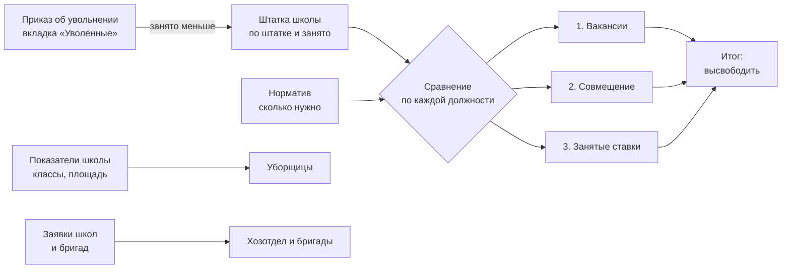
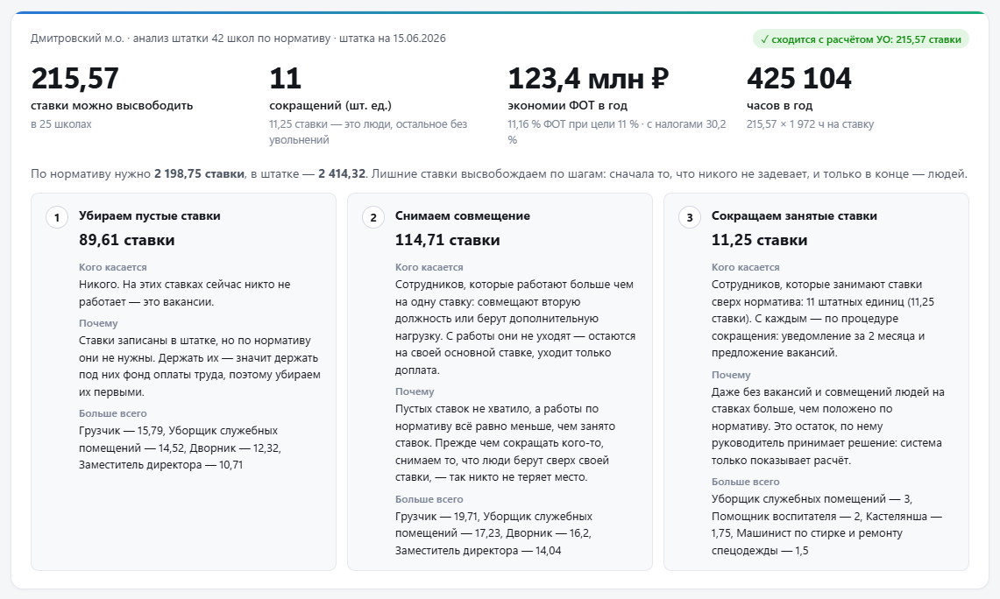
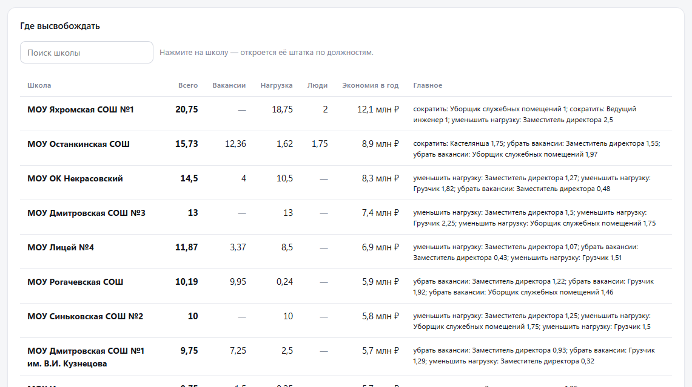
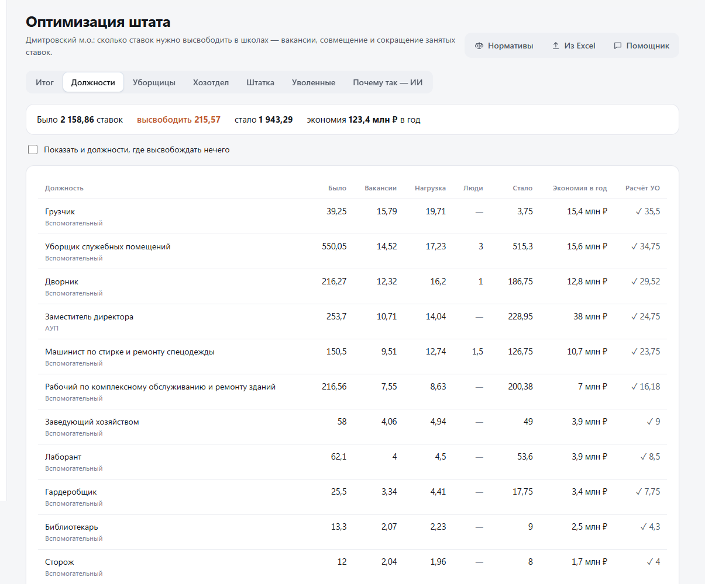
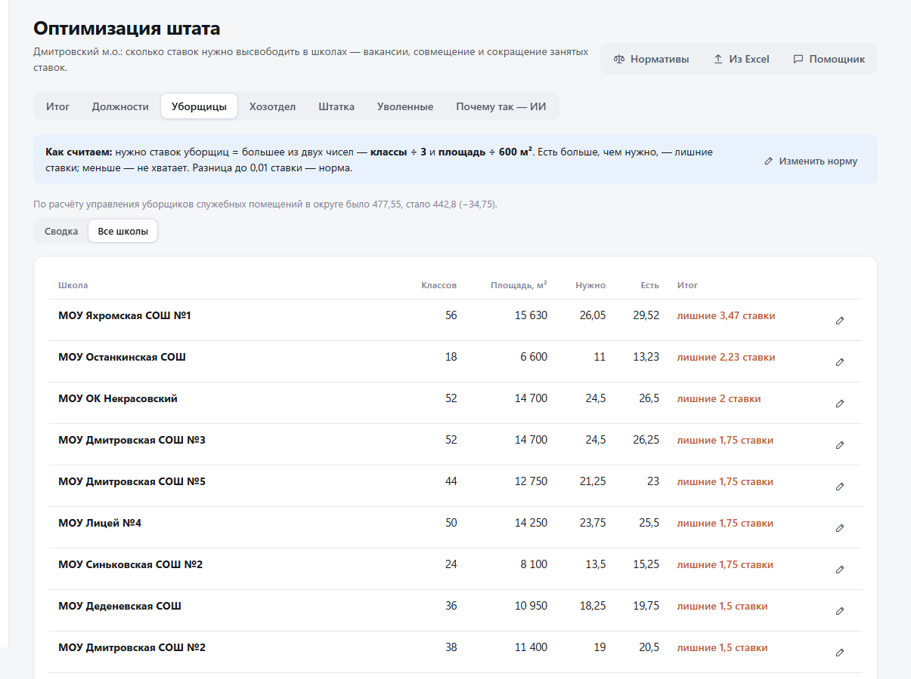
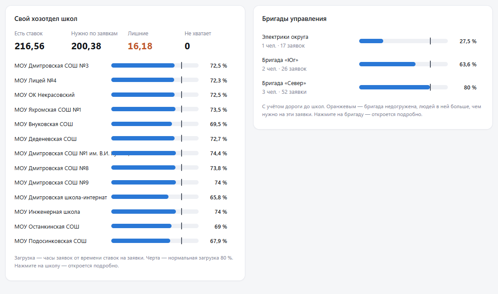
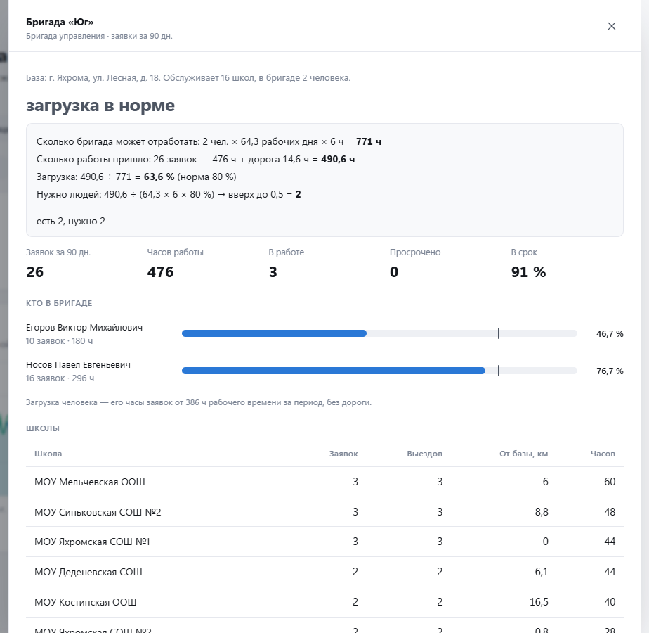
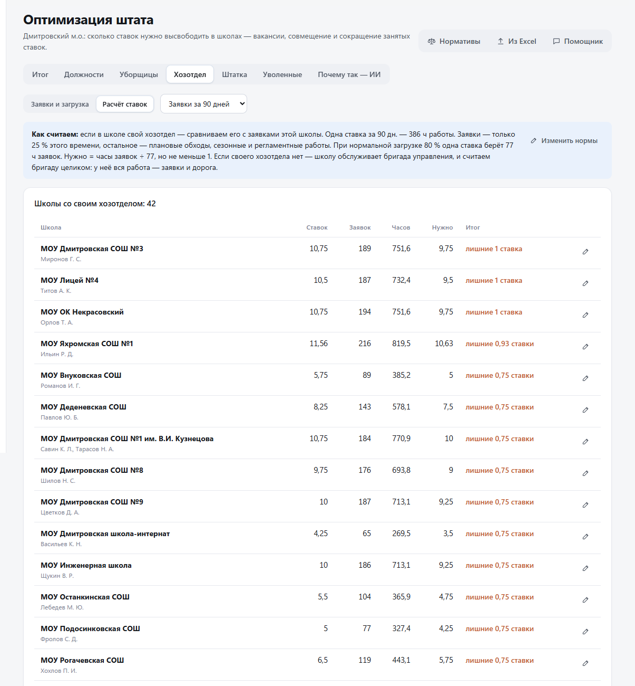
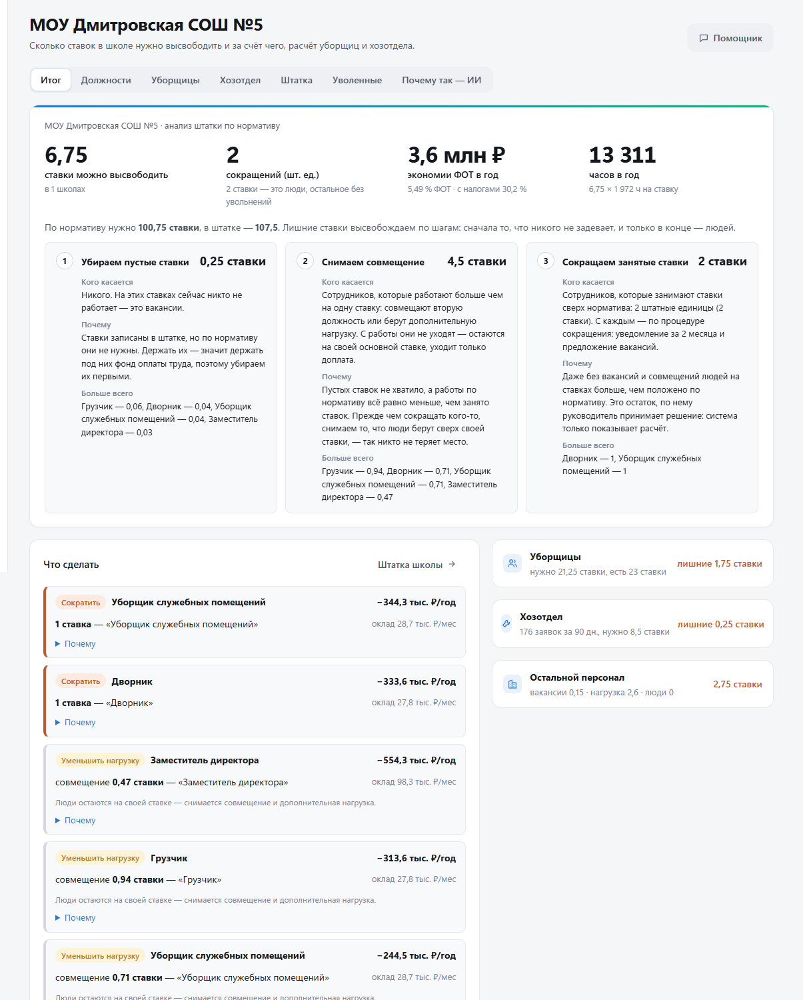
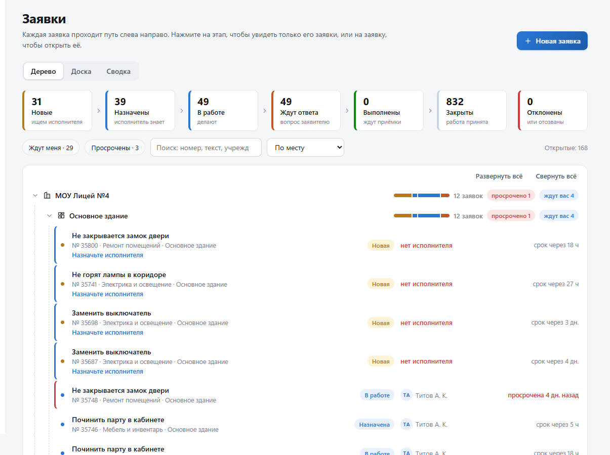

# Руководство: раздел «Оптимизация штата»

Это руководство для тех, кто открывает раздел впервые и не обязан разбираться в кадровых
терминах. Сначала — слова, которые встретятся на экране, потом — откуда берутся цифры,
потом — каждая вкладка по порядку на живых примерах. Все скриншоты сняты с системы
с демо-данными.

Содержание:

1. [Что делает раздел — в двух словах](#1-что-делает-раздел--в-двух-словах)
2. [Словарь](#2-словарь)
3. [Что к чему относится](#3-что-к-чему-относится)
4. [Как система решает — на одном примере](#4-как-система-решает--на-одном-примере)
5. [Вкладки по порядку](#5-вкладки-по-порядку)
6. [Как раздел видит директор школы](#6-как-раздел-видит-директор-школы)
7. [Заявки и откуда они берутся](#7-заявки-и-откуда-они-берутся)
8. [Частые вопросы](#8-частые-вопросы)
9. [Кто что видит](#9-кто-что-видит)

---

## 1. Что делает раздел — в двух словах

У каждой школы есть **штатное расписание** — список должностей и сколько на каждую
положено ставок. Есть и **норматив** — сколько ставок школе действительно нужно при её
числе классов, учеников, площади и объёме работ.

Система сравнивает одно с другим по каждой должности в каждой школе. Если ставок больше,
чем нужно, лишнее нужно **высвободить**. Высвобождать можно тремя способами — от самого
мягкого к самому жёсткому, и система всегда идёт в этом порядке:

1. **убрать пустые ставки** (вакансии) — людей это не касается;
2. **снять совмещение** — человек остаётся на работе, уходит только доплата за вторую
   должность;
3. **сократить занятые ставки** — только то, что осталось после первых двух шагов.

Итог — сколько ставок высвобождается, за счёт чего, в каких школах и по каким должностям,
сколько это экономит фонда оплаты труда в год.

> Высвободить ≠ уволить. Из всего, что высвобождается, увольнения касаются только третьего
> шага. Всё остальное — пустые ставки и доплаты.

---

## 2. Словарь

| Слово | Что значит простыми словами |
|---|---|
| **Ставка** | Единица рабочего времени. 1 ставка — полный рабочий день одного человека. 0,5 ставки — половина. Ставки бывают дробными: 1,75 — это «одна целая и три четверти». |
| **Штатная единица** | Одна строка в штатке — одно «место». На одной штатной единице может быть 1 или 1,5 ставки, поэтому «11 штатных единиц» и «11,25 ставки» — это про одно и то же, просто считается по-разному. |
| **Штатное расписание (штатка)** | Список должностей школы и сколько ставок на каждую. Утверждается директором. |
| **По штатке** | Сколько ставок записано в штатке. |
| **Занято** | Сколько из них реально занято людьми. |
| **Вакансия** | Ставка есть в штатке, но на ней никто не работает. |
| **Совмещение** | Сотрудник, кроме своей ставки, работает ещё на части другой (или своей же) ставки и получает за это доплату. Например, завхоз на 1 ставку + 0,5 ставки дворника. |
| **Норматив (целевая штатка)** | Сколько ставок школе нужно по каждой должности. Зависит от классов, учеников, площади, числа зданий. Задаёт управление образования. |
| **Высвободить** | Убрать лишние ставки любым из трёх способов. |
| **Сократить (занятые ставки)** | Третий способ: ставка занята человеком, но по нормативу не нужна. Тут уже процедура по Трудовому кодексу. |
| **ФОТ** | Фонд оплаты труда — сколько денег уходит на зарплаты. Экономия считается так: высвобожденные ставки × оклад × 12 месяцев (+ налоги 30,2 %). |
| **АУП** | Административно-управленческий персонал: директор, заместители. |
| **Вспомогательный персонал** | Уборщики, рабочие, дворники, гардеробщики, лаборанты и другие. |
| **Хозотдел** | Свой хозяйственный персонал школы: рабочие по обслуживанию здания, завхоз, дворник. |
| **Бригада управления** | Выездная бригада управления образования. Обслуживает сразу несколько школ, приезжает на сложные работы. |
| **Заявка** | Просьба что-то сделать: «течёт кран», «не горит свет в коридоре». По заявкам видно, сколько реально работы у хозотдела и бригад. |
| **Загрузка** | Какая часть рабочего времени людей занята работой. Нормальная — 80 %; ниже — люди простаивают, выше — не успевают. |

---

## 3. Что к чему относится

Цифры раздела собираются из нескольких источников. Важно понимать, что на что влияет,
а что нет:

| Источник | Где вносится | На что влияет |
|---|---|---|
| Штатка школы | «Штатка» → карточка школы, или «Из Excel» | Всё: «Итог», «Должности», «Штатка» |
| Норматив | «Нормативы» (управление образования) | Всё: с ним сравнивается штатка |
| Показатели: классы, площадь, ставки уборщиц | «Уборщицы» → «Внести цифры» | Расчёт уборщиц |
| Заявки | Раздел «Заявки» | Вкладка «Хозотдел»: загрузка своих рабочих и бригад |
| Ставки своего хозотдела | «Хозотдел» → «Расчёт ставок» | Расчёт хозотдела |
| Приказы об увольнении | «Уволенные» | Штатку школы: «занято» по должности уменьшается, ставка становится вакантной. На «Итоге» она переходит из «сократить занятые ставки» в «убрать вакансии» |

Расчёт всегда показывает штатку как она есть сейчас. Если сотрудника уволили и это внесли
в «Уволенные», его ставка в штатке становится вакантной — и «Итог» сразу это покажет:
людей к сокращению станет меньше, вакансий к удалению — больше. Сколько всего ставок
высвободить — не изменится: пустую ставку всё равно нужно убрать из штатки.

---

## 4. Как система решает — на одном примере

Возьмём одну должность в одной школе. На скриншоте — карточка **МОУ Дмитровская СОШ №3**,
должность «Заместитель директора»:

| Что | Сколько |
|---|---|
| Норматив (нужно) | 12,25 ставки |
| По штатке | 13,75 ставки |
| Занято | 13,75 ставки (из них совмещение 1,5) |

Как система рассуждает:

1. **Есть ли лишнее?** По штатке 13,75, а нужно 12,25. Лишние — 13,75 − 12,25 = **1,5 ставки**.
2. **Шаг 1 — вакансии.** Занято 13,75 из 13,75, пустых ставок нет. Здесь ничего не убрать.
3. **Шаг 2 — совмещение.** Из занятых 13,75 ставок 1,5 — это совмещение (люди работают
   сверх своей ставки). Снимаем 1,5 ставки совмещения. Лишнего больше не осталось.
4. **Шаг 3 — сокращение.** Остаток 0 — **никого не увольняем**.

Итог по этой должности: «высвободить 1,5 ставки (нагрузка 1,5)» — заместители остаются на
своих ставках, уходят только доплаты.

Тот же расчёт идёт по каждой должности каждой школы. Если в какой-то должности пустых
ставок и совмещений не хватает, остаток попадает в третий шаг — и только тогда речь идёт
о людях. Кнопка **«Почему»** рядом с каждой должностью раскрывает этот расчёт словами.

**Почему именно такой порядок.** Пустая ставка никого не задевает, а деньги под неё
заложены — её убирают первой. Снять совмещение — человек остаётся на работе. Сокращение
занятой ставки — самый болезненный шаг, поэтому он последний и только на то, что осталось.

**Допуск.** Расхождение до 0,25 ставки или 5 % от нормы считается нормой: из-за округления
четверть ставки сокращать не нужно.

---

## 5. Вкладки по порядку

Раздел открывается из меню слева: **«Оптимизация штата»**. Наверху — вкладки, справа
вверху — кнопки «Нормативы», «Из Excel» и «Помощник».

### 5.1. Итог

Главная страница раздела. Сверху — общий итог по округу:

| Цифра | Что значит |
|---|---|
| **215,57 ставки можно высвободить** | Сумма всех трёх шагов по всем школам. «В 25 школах» — в стольких школах есть что высвобождать; в остальных штатка в норме. |
| **11 сокращений (шт. ед.)** | Сколько штатных единиц приходится на третий шаг, то есть на людей. Под ним — те же 11,25 в ставках. |
| **123,4 млн ₽ экономии ФОТ в год** | Высвобожденные ставки × оклад × 12 месяцев с налогами. Рядом — сколько это процентов от всего ФОТ и какая была цель. |
| **425 104 часов в год** | Сколько рабочих часов высвобождается: ставки × 1 972 часа (годовая норма на одну ставку). |
| Зелёная метка справа | Цифры системы совпали с расчётом управления образования. Если не совпадут — метка станет жёлтой и покажет цифру управления. |

Ниже — фраза «по нормативу нужно … ставки, в штатке — …» и три карточки шагов. В каждой:
**кого касается** (простыми словами), **почему** и **больше всего** — по каким должностям
этот шаг даёт больше всего ставок.

Дальше — то же самое по трём группам персонала. Нажмите на карточку — откроется
соответствующая вкладка:

«Вакансии / нагрузка / люди» в каждой карточке — это те же три шага: сколько ставок
убирается пустыми, сколько снимается совмещением и сколько — сокращением занятых.

Ниже — таблица **«Где высвобождать»** по школам. Нажмите на строку — откроется штатка
этой школы по должностям (как в примере из раздела 4):

Столбец «Главное» — три самых крупных действия в школе. Школы, где высвобождать нечего,
стоят внизу с пометкой «в норме».

### 5.2. Должности

Та же картина, но по должностям по всему округу: сколько было, сколько уходит вакансиями,
нагрузкой и людьми, сколько станет и какая экономия.

Пример из первой строки: **грузчиков** было 39,25 ставки, станет 3,75. Из 35,5 высвобождаемых
ставок 15,79 — пустые, 19,71 — совмещение, людей не сокращают (прочерк в «Люди»).

Галочка в столбце «Расчёт УО» — цифра по должности совпала с расчётом управления
образования. Флажок «Показать и должности, где высвобождать нечего» добавит в таблицу
должности, которые в норме.

### 5.3. Уборщицы

Отдельный простой расчёт: сколько ставок уборщиц нужно школе.

**Правило:** нужно ставок = **большее** из двух чисел:

- число классов ÷ 3 (одна ставка на 3 класса);
- площадь ÷ 600 м² (одна ставка на 600 м²).

Большее — потому что убрать надо и все классы, и всю площадь. Нормы (3 класса и 600 м²)
меняет управление образования кнопкой «Изменить норму».

Пример — **МОУ Дмитровская СОШ №5**:

| | |
|---|---|
| По классам | 44 класса ÷ 3 = 14,67 ставки |
| По площади | 12 750 м² ÷ 600 = 21,25 ставки |
| Нужно (большее) | **21,25** |
| Есть | 23 |
| Итог | 23 − 21,25 = **лишние 1,75 ставки** |

Для сравнения **МОУ Катуаровская СОШ**: 30 классов ÷ 3 = 10, 6 000 м² ÷ 600 = 10, есть 10 —
**в норме**.

Вид **«Сводка»** — дашборд по округу:

- **Школ с данными** — сколько школ внесли три цифры (классы, площадь, ставки).
- **Сколько метров убирает одна ставка** — площадь ÷ ставки. Черта — норма 600 м². Полоса
  левее черты — уборщиц больше, чем нужно по площади (оранжевая — в школе лишние ставки).
- **Школы по итогу** — сколько школ с лишними, в норме, с нехваткой и без данных; ниже —
  где лишних больше всего и где не хватает.
- **Заявки на уборку** — если школы оформляют уборку заявками, здесь видно, справляются ли.

Вид **«Все школы»** — таблица с расчётом по каждой школе. Карандаш справа — внести или
поправить три цифры школы:

### 5.4. Хозотдел

Здесь — заявки на хозяйственные работы и хватает ли на них людей. Сверху можно выбрать
период: 30, 90, 180 дней или год.

Вид **«Заявки и загрузка»**:

| Блок | Что показывает |
|---|---|
| **Пришло за 90 дн.** | Сколько заявок пришло и сколько это часов работы мастеров. |
| **В работе сейчас** | Открытые заявки; сколько из них ещё без исполнителя. |
| **Просрочено** | Срок вышел, работа не сдана. |
| **Сделано в срок** | Доля выполненных до срока и среднее время выполнения. |
| **Заявки по дням** | Синяя линия — пришло, зелёная — выполнено. Если синяя долго выше зелёной, заявки копятся. |
| **Кто выполняет** | Сколько часов работы у бригад управления и у своих хозотделов школ. Ниже — статусы, срочность и сложность заявок. |
| **Что чинят** | Темы заявок, среднее время выполнения, просрочка. |
| **Откуда больше всего** | Школы с наибольшим числом заявок. |
| **Исполнители** | Кто сколько держит в работе, сколько просрочил и сделал. |

Ниже — хватает ли людей:

- **Свой хозотдел школ** — сколько ставок есть, сколько нужно по заявкам, лишние и нехватка;
  полосы — загрузка каждой школы.
- **Бригады управления** — загрузка каждой бригады с учётом дороги до школ. Черта —
  нормальная загрузка 80 %. Оранжевая полоса — бригада недогружена.

**Подробно по бригаде или школе.** Нажмите на строку бригады или школы — справа откроется
карточка. У бригады: как получилась загрузка по шагам (сколько может отработать, сколько
пришло работы и дороги, сколько нужно людей), кто в бригаде и сколько часов у каждого,
какие школы она обслуживает (заявки, выезды, расстояние от базы), что чинили и последние
заявки:

У школы: расчёт «нужно ставок» по шагам, кто из хозотдела заведён в системе и сколько
заявок закрыл, что чинили, последние заявки и сколько сложных работ ушло бригаде:

Если в системе заведено меньше рабочих, чем ставок, все заявки записаны на тех, кто есть.
Карточка об этом предупредит: сравнивать загрузку по людям в такой школе нельзя, и
сокращать «по загрузке» система не предлагает.

Вид **«Расчёт ставок»** — как получилось «нужно» по каждой школе:

**Как считается.** Важно: заявки — это не вся работа хозотдела. Большую часть времени
рабочие делают то, что заявками не оформляют: обходы здания, плановые проверки, сезонные
работы, территория. Поэтому заявкам отводится только часть времени — по умолчанию **25 %**.

| Шаг | Пример — МОУ Дмитровская СОШ №5 |
|---|---|
| Одна ставка за 90 дней | 64 рабочих дня × 6 ч = 386 ч |
| Из них на заявки | 25 % |
| При нормальной загрузке 80 % одна ставка берёт | 386 × 25 % × 80 % ≈ **77 ч заявок** |
| Заявок за 90 дней | 176 заявок = 655,2 ч |
| Нужно | 655,2 ÷ 77 ≈ **8,5 ставки** |
| Есть | 8,75 |
| Итог | лишние **0,25 ставки** |

У **бригад управления** вся работа — это заявки плюс дорога до школ, поэтому считается
по-другому. Пример — **Бригада «Север»**: 3 человека, 26 школ, 52 выезда за 90 дней —
892 ч работы и 34 ч дороги. Ёмкость — 3 × 386 = 1 158 ч. Загрузка — (892 + 34) ÷ 1 158 ≈
**80 %**, то есть ровно норма.

Кнопка **«Изменить нормы»** (у управления образования) меняет: долю времени на заявки,
нормальную загрузку, рабочих часов в день, часов на заявку без оценки, скорость бригады
в дороге и минимум людей. Расчёт сразу пересчитается.

Если у школы нет своего хозотдела, её обслуживает бригада: такие школы перечислены
отдельно, и их работа считается в расчёте бригады.

### 5.5. Штатка

Список школ со штаткой: сколько ставок, сколько занято, укомплектованность, ФОТ и сколько
высвободить. Экономия здесь — по окладам, без налогов, поэтому она меньше, чем на «Итоге»
(там добавлены налоги 30,2 %).

Нажмите на школу — откроется её штатка по должностям (скриншот в разделе 4). В карточке:

- сверху — по штатке, занято, вакантно, ФОТ и сколько высвободить;
- по каждой должности — норматив, по штатке, занято, вакантно, оклад, ФОТ;
- красным — что сделать с должностью, кнопка **«Почему»** — расчёт словами;
- карандаш — поправить строку, корзина — убрать, **«+ должность»** — добавить;
- внизу — **«Показатели и утверждение штатки»** (классы, ученики, площадь, статус штатки)
  и **«Спросить помощника»** про эту школу.

В расчёте участвует только **утверждённая** штатка. Черновик система видит, но не считает.

### 5.6. Уволенные

Здесь ведутся приказы, которыми школы уже оформили сокращение занятых ставок или
увольнение по собственному желанию: кто, из какой школы, должность, ставка, основание,
номер и дата приказа.

**Как запись меняет расчёт.** Увольнение, учтённое в штатке, освобождает ставку
уволенного. Пример: в школе уборщиков по нормативу 5, в штатке 7, все 7 заняты — система
предлагает сократить 2 занятые ставки. Внесли приказ об увольнении одного уборщика:

| | До приказа | После приказа |
|---|---|---|
| Штатка: по штатке / занято | 7 / 7 | 7 / **6** |
| «Итог»: убрать вакансии | 0 | **1** |
| «Итог»: сократить занятые ставки | 2 | **1** |
| Всего высвободить | 2 | 2 |

Всего высвободить по-прежнему 2: пустую ставку тоже нужно убрать из штатки. В истории
штатки появится версия «увольнение по приказу». Удалили запись или нажали **«Вернуть»** —
ставка снова занята, цифры возвращаются.

Колонка **«В штатке»** показывает, учтена ли запись: «учтено: «Уборщик…»: занято −1» или
«не учтено». Записи, загруженные из документов управления образования, в штатке не учтены:
анализ показывает состояние до этих увольнений. Кнопка **«Учесть в штатке»** применяет
запись. Если в штатке школы нет такой должности с занятыми ставками, система об этом
скажет — поправьте должность в записи или штатку.

Таблица **«Откуда берутся „сократить занятые ставки“»** — сверка по каждой школе:

- **В расчёте УО** — сколько ставок «людьми» в этой школе по расчёту управления образования;
- **По приказам** — сколько подтверждено записями ниже;
- **Сверка**: «сходится» — приказов ровно на столько, сколько в расчёте; «разница» — приказов
  меньше (не все внесены) или больше.

Как работать с записями (специалист управления образования, региональный аналитик
и администратор):

1. **Добавить** — кнопка «+ Добавить» → школа, ФИО, должность, ставка, основание
   (по собственному желанию или сокращение штата), номер и дата приказа, дата увольнения.
   Для сокращения — ещё дата уведомления. Статья ТК подставится сама. Флажок «Учесть
   в штатке школы» включён: ставка в штатке сразу станет вакантной.
2. **Изменить** — карандаш в строке.
3. **Удалить** — корзина в строке, система переспросит.

Фильтр по школе и поиск по ФИО, должности или номеру приказа — над таблицей. Директор
видит только свою школу и не редактирует. Наблюдатель видит записи без фамилий.

На вкладках «Итог», «Уборщицы» и в разъяснениях ИИ фамилий нет — только сколько ставок
и каким способом высвобождается.

### 5.7. Почему так — ИИ

Разъяснения от локальной языковой модели: она отвечает на вопросы о высвобождении простыми
словами по схеме **«Почему» — «Откуда это берётся» — «Как это делается» — «Что дальше
с сотрудником»**.

Как пользоваться:

1. Выберите школу (или оставьте «Весь округ») и должность (или «Все должности»).
2. Нажмите один из готовых вопросов или напишите свой и нажмите «Спросить».
3. Ответ печатается по ходу — ждать конца не нужно. «Остановить» прерывает ответ,
   «Очистить» начинает разговор заново.

Что модель знает: итог расчёта по выбранной школе или округу, разбивку по должностям
на вакансии, совмещение и сокращение, порядок высвобождения и общие нормы Трудового
кодекса при сокращении (уведомление за 2 месяца, предложение вакансий, выходное пособие).
Фамилий и приказов она не видит.

Модель работает на сервере округа, данные никуда не уходят. Пока вкладка открыта, модель
заранее читает справку по выбранной школе — поэтому ответ начинается через секунду-две.
Полный ответ занимает 20–40 секунд, это скорость самой модели.

Модель может ошибиться в формулировке. Цифры всегда можно проверить на «Итоге» и в карточке
школы — они считаются системой, а не моделью.

### 5.8. Кнопки справа вверху

- **Нормативы** — сколько ставок положено по каждой должности и от чего это зависит.
  Ведёт управление образования; у каждого норматива есть документ-основание.
- **Из Excel** — загрузить штатки или показатели школ файлом вместо ручного ввода.
- **Помощник** — чат по всему разделу: нормативы, штатки, ФОТ, кадровые заявки.
  В отличие от «Почему так — ИИ», он видит больше, но отвечает дольше и разговоры сохраняет.

---

## 6. Как раздел видит директор школы

Директор видит только свою школу. «Итог» у него — не по округу, а по школе, и вместо
таблицы школ — список **«Что сделать»**: какие действия, по каким должностям и сколько
каждое экономит в год.

Пример — **МОУ Дмитровская СОШ №5**: высвободить 6,75 ставки = 0,25 (вакансии) + 4,5
(совмещение) + 2 (занятые ставки: 1 уборщик и 1 дворник). Справа — короткие итоги по
уборщицам, хозотделу и остальному персоналу; нажмите — откроется расчёт.

Директор вносит данные своей школы: штатку, показатели, три цифры для уборщиц, ставки
своего хозотдела.

---

## 7. Заявки и откуда они берутся

Раздел **«Заявки»** в меню слева — это заявки школ на хозяйственные работы: сотрудник
школы пишет, что сломалось, система сама определяет тему, исполнителя и срок.

Для раздела «Оптимизация штата» заявки важны тем, что показывают реальный объём работы:

- простые работы делает свой хозотдел школы;
- сложные (замена труб, ремонт кабинета, электрика по всей школе) уходят бригаде управления.

Из этих заявок вкладка «Хозотдел» считает загрузку людей и сколько их нужно.

---

## 8. Частые вопросы

**Высвободить 215,57 ставки — значит уволить 215 человек?**
Нет. Из них 89,61 — пустые ставки, 114,71 — снятие совмещения (люди остаются), и только
11,25 ставки (11 штатных единиц) — занятые ставки, по которым нужна процедура сокращения.

**Почему в школе пишет «в норме», хотя вроде бы людей много?**
Значит, по каждой должности штатка не больше норматива (с допуском 0,25 ставки или 5 %).
17 школ округа сейчас именно такие.

**Я внёс увольнение, а «всего высвободить» на «Итоге» не изменилось. Это ошибка?**
Нет. Ставка уволенного стала вакантной, и на «Итоге» она перешла из «сократить занятые
ставки» в «убрать вакансии» — общая цифра та же, поменялся способ. Убрать эту ставку из
штатки всё равно нужно.

**Я удалил запись, а цифры не изменились.**
Значит, запись не была учтена в штатке (колонка «В штатке» — «не учтено»): так загружены
приказы из документов управления. Удалять такую запись можно — штатку это не меняет.

**Почему хозотдел считается только по 25 % времени?**
Потому что заявками оформляется не вся работа: обходы, плановое обслуживание, сезонные
работы и уборка территории идут без заявок. Если в вашем округе иначе — управление
образования меняет долю кнопкой «Изменить нормы» на вкладке «Хозотдел».

**Как поменять данные школы?**
Штатка — «Штатка» → школа → карандаш у должности или «+ должность»; показатели —
«Показатели и утверждение штатки» в карточке школы; уборщицы — «Уборщицы» → карандаш;
хозотдел — «Хозотдел» → «Расчёт ставок» → карандаш. Всё пересчитывается сразу.

**Почему сумма по уборщицам на «Итоге» и на вкладке «Уборщицы» может отличаться?**
На «Итоге» уборщики считаются по нормативу из «Нормативов», на вкладке «Уборщицы» — по
простому правилу «классы ÷ 3 или площадь ÷ 600». Это два взгляда на одно и то же: если они
расходятся, стоит проверить норматив или показатели школы.

**ИИ ответил странно. Ему можно верить?**
Цифры в ответе взяты из расчёта системы, но формулировку модель придумывает сама и может
ошибиться. Проверяйте по «Итогу» и карточке школы. Если модель недоступна, вкладка
об этом скажет — остальной раздел работает как обычно.

---

## 9. Кто что видит

| Роль | Что видит | Что меняет |
|---|---|---|
| Администратор | Всё | Всё, включая состав бригад |
| Региональный аналитик | Весь регион | Нормативы, штатки, показатели, нормы уборщиц и хозотдела, «Уволенные», загрузка из Excel |
| Специалист управления образования | Свой округ | Местные нормативы, штатки, показатели, нормы уборщиц и хозотдела, «Уволенные», загрузка из Excel |
| Директор | Свою школу | Штатку, показатели, цифры уборщиц и хозотдела своей школы |
| Наблюдатель | Сводки и таблицы, без фамилий и карточек школ | Ничего |
| Сотрудник, хозслужба, бригада | Раздел не видят — только заявки | Свои заявки |

Все изменения штаток, показателей, нормативов и записей об увольнениях пишутся в журнал
действий («Администрирование»).

---

Скриншоты обновляются командой `node scripts/guide-screens.mjs` при запущенной системе
(`docker compose up -d`).
